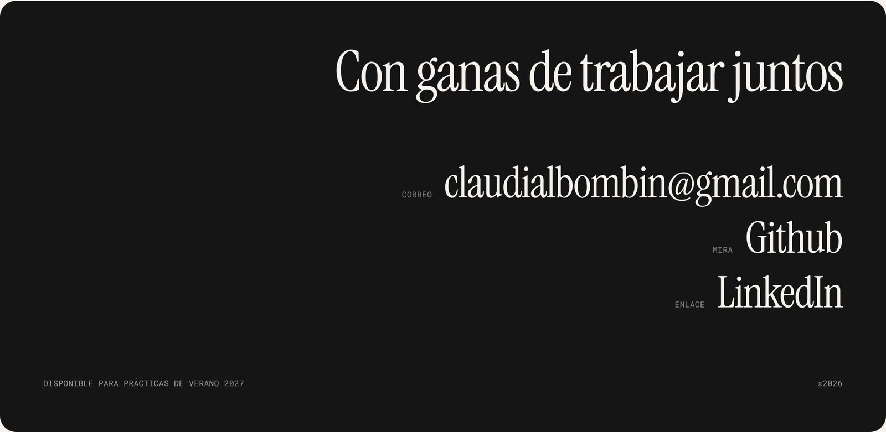

<a href="https://claudialbombin.github.io/"></a>

<p align="center">
  <b><a href="https://claudialbombin.github.io/">▶ Visita la web</a></b> &nbsp;·&nbsp; <a href="README.md">English</a> · <b>Español</b>
</p>

# claudialbombin.github.io

Mi portfolio personal: trece proyectos de modelización cuantitativa, simulación y software. Cada uno tiene su propia página con la pregunta, el método, las cifras y las limitaciones. Es bilingüe (español e inglés) y funciona como un único HTML estático en GitHub Pages.

Los proyectos viven en sus propios repositorios; este repo es solo la web. La lista está en la [web](https://claudialbombin.github.io/#/works) y en mi [perfil de GitHub](https://github.com/claudialbombin).

## Lo que merece la pena mirar

- **Un archivo, sin build.** Contenido, estilos y scripts están en `index.html`: JavaScript plano, sin framework, sin bundler y sin más dependencias que tres Google Fonts. Pages lo sirve tal cual.
- **Router por hash.** Cada vista tiene su URL (`#/works/pitwall`, `#/about`), así que los enlaces directos y el botón de atrás funcionan en GitHub Pages sin ninguna página 404 de rescate.
- **Bilingüe por construcción.** Cada texto es un par `{ en, es }`, así que una traducción que falta aparece como un hueco en los datos y no como una frase suelta en inglés. El idioma elegido se recuerda en `localStorage`.
- **Un laboratorio de Monte Carlo en vivo.** "Juega con los números" simula un movimiento browniano geométrico en un canvas. Reutiliza los mismos números aleatorios en cada ejecución (números aleatorios comunes), así que mover la deriva o la volatilidad solo cambia lo que cambian los parámetros. La media y los cuantiles exactos se dibujan junto a las estimaciones para ver cómo la simulación coincide con la fórmula cerrada.
- **Portadas generadas.** Las portadas se dibujan en canvas a partir de un generador con semilla (un hash FNV-1a que alimenta un PRNG mulberry32). Son deterministas por proyecto, no pesan nada y la página las identifica como ilustración, no como resultado del proyecto.
- **"Últimas novedades en GitHub" en directo.** Una única llamada sin autenticar a la API de GitHub, cacheada una hora. Si la API no responde o llega al límite, se muestra una lista escrita a mano.
- **Accesibilidad.** Respeta `prefers-reduced-motion`, usa encabezados reales y controles etiquetados, y las fotos que fallan no dejan marcos rotos.

<a href="https://claudialbombin.github.io/"></a>

## Ejecutarla en local

```bash
git clone https://github.com/claudialbombin/claudialbombin.github.io.git
cd claudialbombin.github.io
python3 -m http.server 8000      # y abre http://localhost:8000
```

También funciona abriendo `index.html` directamente; el servidor local solo importa para el bloque de GitHub.

## Estructura

```
index.html        toda la web: contenido, estilos y scripts
assets/           fotos que usa la web
assets/readme/    capturas que solo usan estos README
.nojekyll         indica a GitHub Pages que sirva los archivos tal cual
README.es.md      este archivo (README.md es la versión en inglés)
```

## Editar el contenido

Todo lo que dice la web está en datos al principio del script de `index.html`:

| Para cambiar… | Edita |
|---|---|
| La página de un proyecto | su entrada en `P` (`slug`, `name`, `repo`, `cat`, `short`, `lead`, `figs`, `secs`). Las páginas se generan a partir de estos campos. |
| Textos de la interfaz | el objeto `T` (cada clave es `{ en, es }`) |
| "Ahora mismo" | `T.now` |
| La lista de respaldo de GitHub | `RECENT` (sus frases sustituyen también a las descripciones de los repos en la lista en directo) |

## Despliegue

GitHub Pages publica desde la raíz de `main`. Un push está en línea en un par de minutos.

## Contacto

<a href="mailto:claudialbombin@gmail.com"></a>

[claudialbombin@gmail.com](mailto:claudialbombin@gmail.com) · [GitHub](https://github.com/claudialbombin) · [LinkedIn](https://www.linkedin.com/in/claudia-lopez-bombin) · Disponible para prácticas en verano de 2027.
