<a href="https://claudialbombin.github.io/"></a>

<p align="center"><b><a href="#mis-trabajos">Trabajos</a></b> &nbsp;/&nbsp; <b><a href="#sobre-mí">Sobre mí</a></b> &nbsp;/&nbsp; <b><a href="#contacto">Contacto</a></b> &nbsp;/&nbsp; <b><a href="https://claudialbombin.github.io/">Visita la web ↗</a></b></p>

<p align="center"><a href="README.md">English</a> · <b>Español</b></p>

> **Desde Madrid, movida por la curiosidad.** Claudia Lopez es una ingeniera y oradora española afincada en Madrid, estudia Ingeniería Matemática e IA y construye modelos estocásticos para finanzas.


<p align="center"></p>

## Mis trabajos

Simulación, modelado estocástico y software, desde trabajos de clase hasta cosas que hice porque quería que existieran. Cada proyecto tiene su propia página con la pregunta, el método y las cifras.

<table>
<tr>
<td width="50%" valign="top"><a href="#project-pitwall">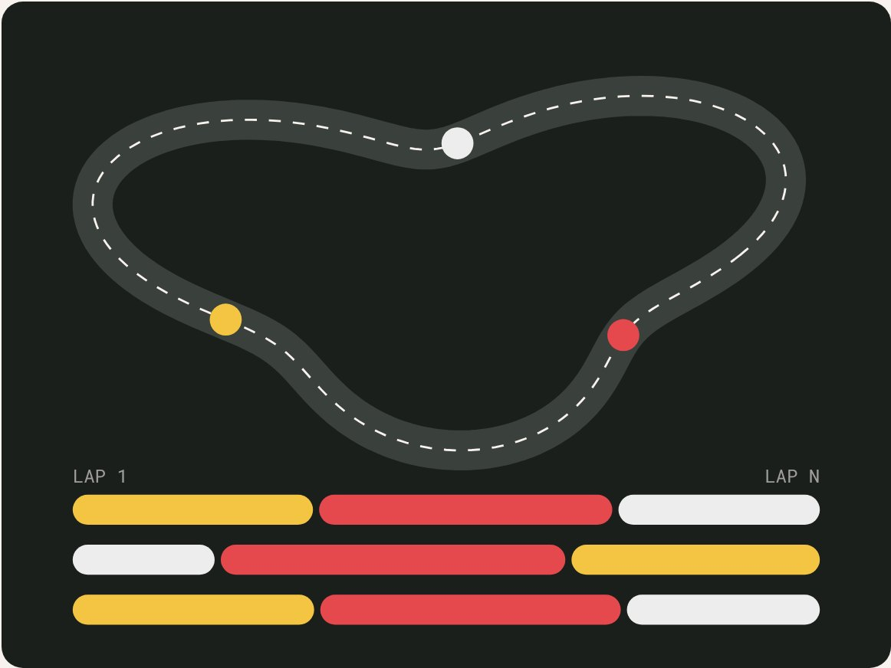</a><br><sub><code>/01</code> &nbsp; <code>CUANTITATIVO Y SIMULACIÓN</code></sub><br><b><a href="#project-pitwall">Pitwall</a></b><br>Cuándo parar en boxes en Fórmula 1, resuelto como una opción americana y sin maquillar el resultado.</td>
<td width="50%" valign="top"><a href="#project-beat-the-dealer">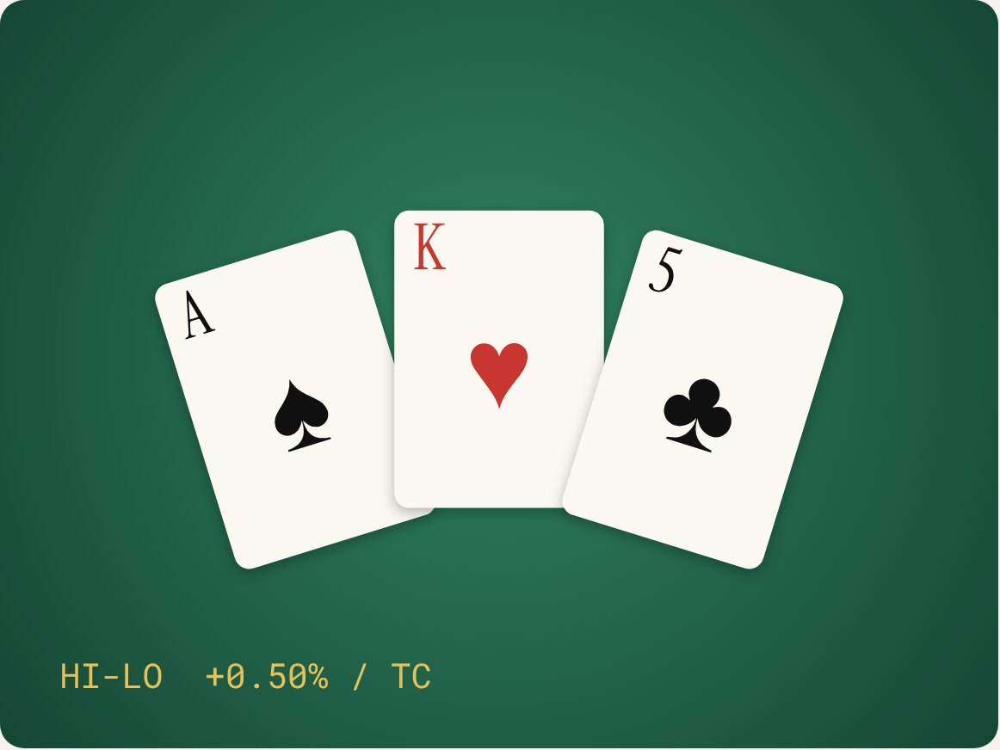</a><br><sub><code>/02</code> &nbsp; <code>CUANTITATIVO Y SIMULACIÓN</code></sub><br><b><a href="#project-beat-the-dealer">Beat the Dealer</a></b><br>Blackjack resuelto por simulación, comprobado con un solver exacto y contado en mil millones de rondas.</td>
</tr>
<tr>
<td width="50%" valign="top"><a href="#project-monte-carlo-option-pricer">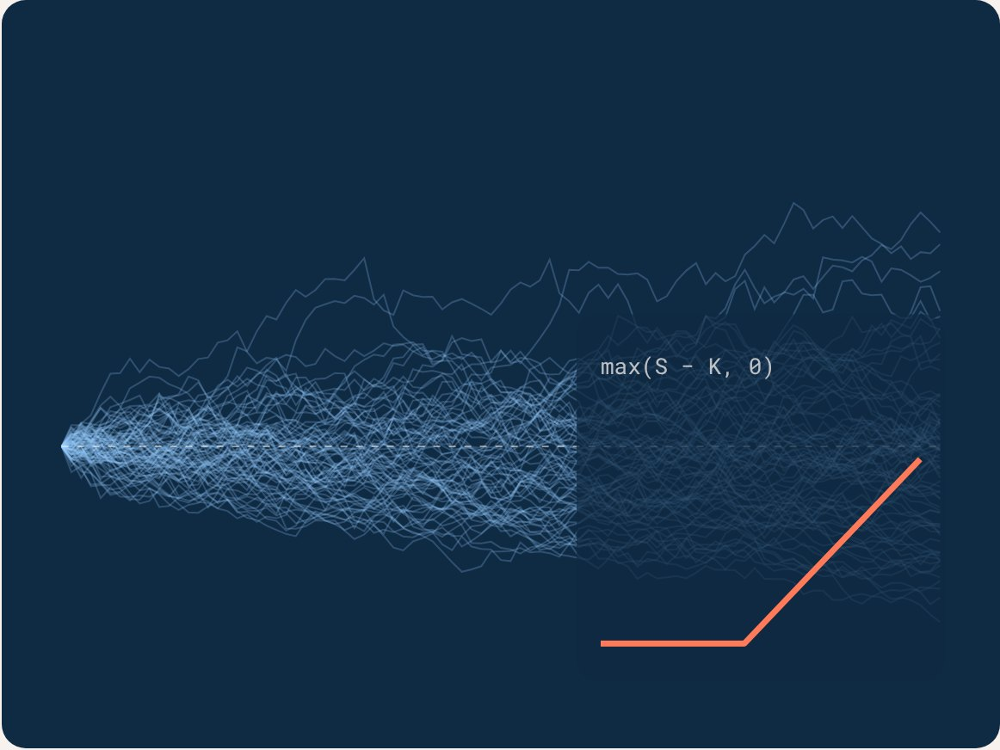</a><br><sub><code>/03</code> &nbsp; <code>CUANTITATIVO Y SIMULACIÓN</code></sub><br><b><a href="#project-monte-carlo-option-pricer">Option Pricer</a></b><br>Opciones europeas, asiáticas y con barrera bajo Black-Scholes y Heston, en Python y C.</td>
<td width="50%" valign="top"><a href="#project-salchi-helper">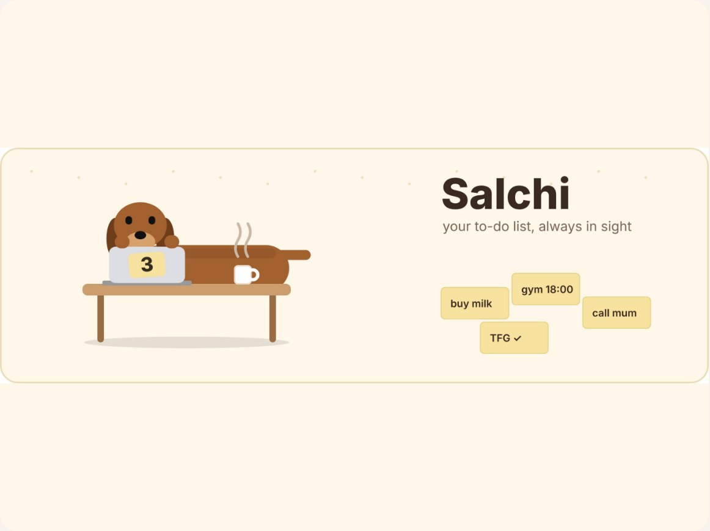</a><br><sub><code>/04</code> &nbsp; <code>SOFTWARE</code></sub><br><b><a href="#project-salchi-helper">Salchi</a></b><br>Un salchicha flotante que mantiene tu lista de tareas a la vista, en Mac, Windows y Linux.</td>
</tr>
<tr>
<td width="50%" valign="top"><a href="#project-cececat">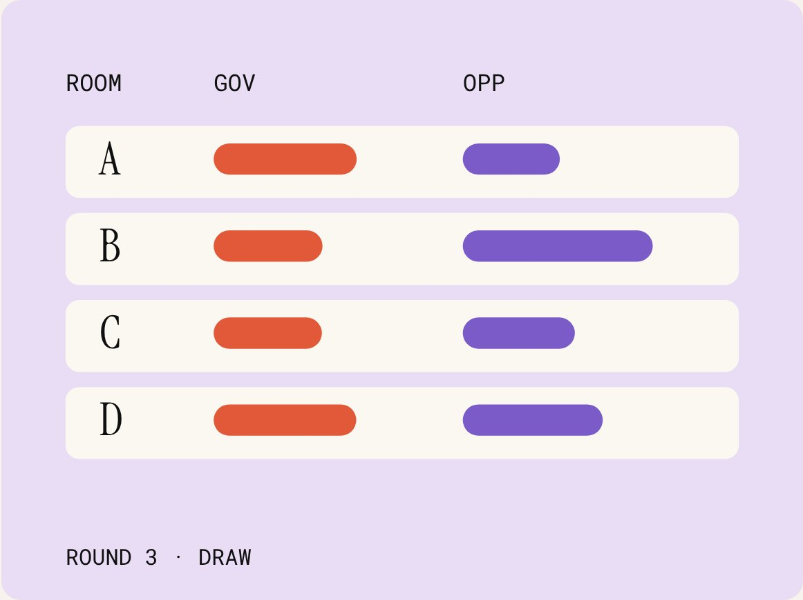</a><br><sub><code>/05</code> &nbsp; <code>SOFTWARE</code></sub><br><b><a href="#project-cececat">CeceCat</a></b><br>Un gestor de torneos de debate que funciona entero desde una sola página web.</td>
<td width="50%" valign="top"><a href="#project-scm-heston-filter">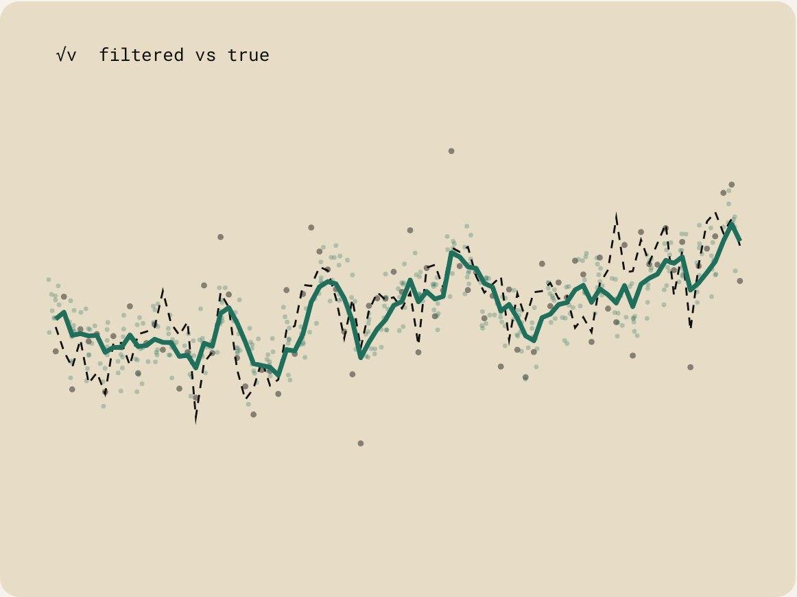</a><br><sub><code>/06</code> &nbsp; <code>CUANTITATIVO Y SIMULACIÓN</code></sub><br><b><a href="#project-scm-heston-filter">Heston Filter</a></b><br>Un filtro de partículas que sigue una volatilidad que nadie observa.</td>
</tr>
<tr>
<td width="50%" valign="top"><a href="#project-tfg">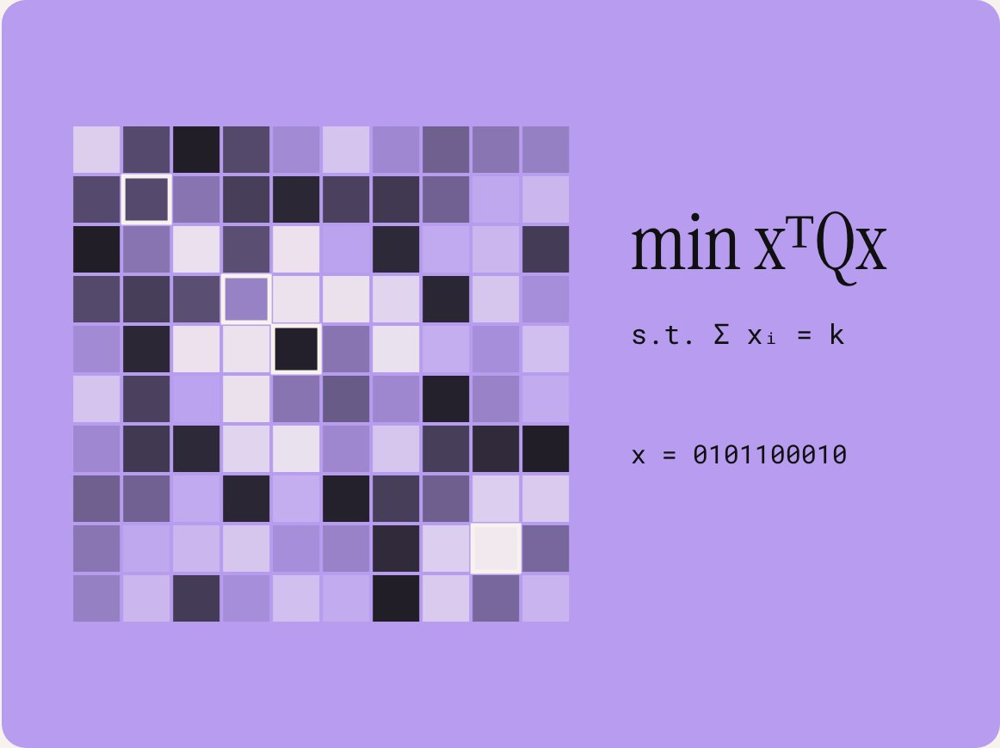</a><br><sub><code>/07</code> &nbsp; <code>CUANTITATIVO Y SIMULACIÓN</code></sub><br><b><a href="#project-tfg">QUBO Thesis</a></b><br>Selección de carteras como un problema que un quantum annealer puede leer.</td>
<td width="50%" valign="top"><a href="#project-pause"></a><br><sub><code>/08</code> &nbsp; <code>SOFTWARE</code></sub><br><b><a href="#project-pause">Pause</a></b><br>Un ejercicio de respiración antes de las apps que no puedes soltar.</td>
</tr>
<tr>
<td width="50%" valign="top"><a href="#project-recetario-familiar"></a><br><sub><code>/09</code> &nbsp; <code>SOFTWARE</code></sub><br><b><a href="#project-recetario-familiar">Recetario</a></b><br>Un recetario familiar acogedor con tapa que se abre, en la web.</td>
<td width="50%" valign="top"><a href="#project-a-maze-ing">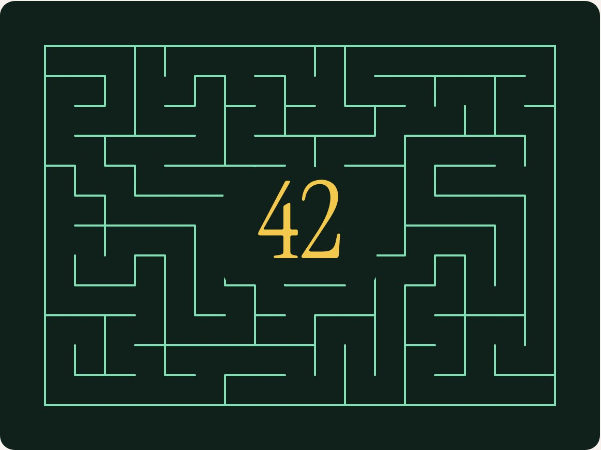</a><br><sub><code>/10</code> &nbsp; <code>SOFTWARE</code></sub><br><b><a href="#project-a-maze-ing">A-Maze-ing</a></b><br>Un generador de laberintos reproducible con un “42” en el centro, en Python, en 42 Madrid.</td>
</tr>
<tr>
<td width="50%" valign="top"><a href="#project-push-swap">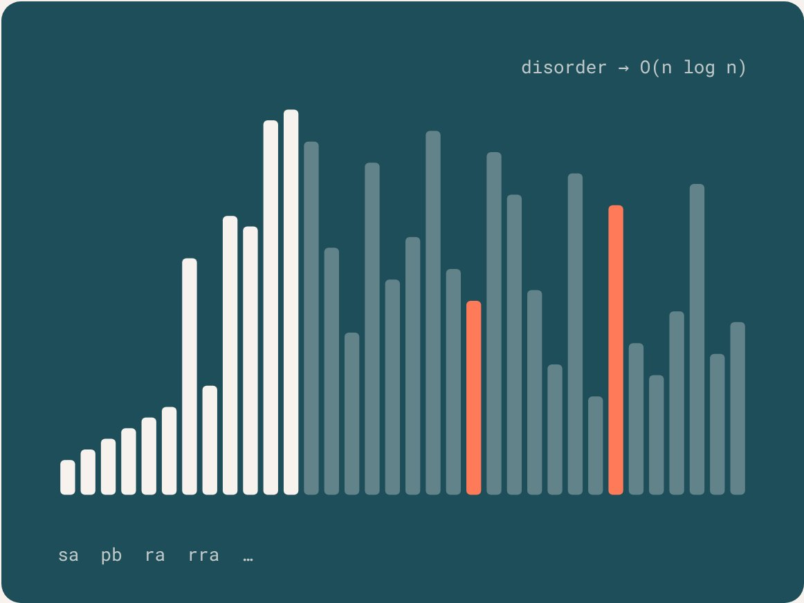</a><br><sub><code>/11</code> &nbsp; <code>SOFTWARE</code></sub><br><b><a href="#project-push-swap">push_swap</a></b><br>Ordenar con dos pilas y un puñado de movimientos, en C, en 42 Madrid.</td>
<td width="50%" valign="top"><a href="#project-2imat">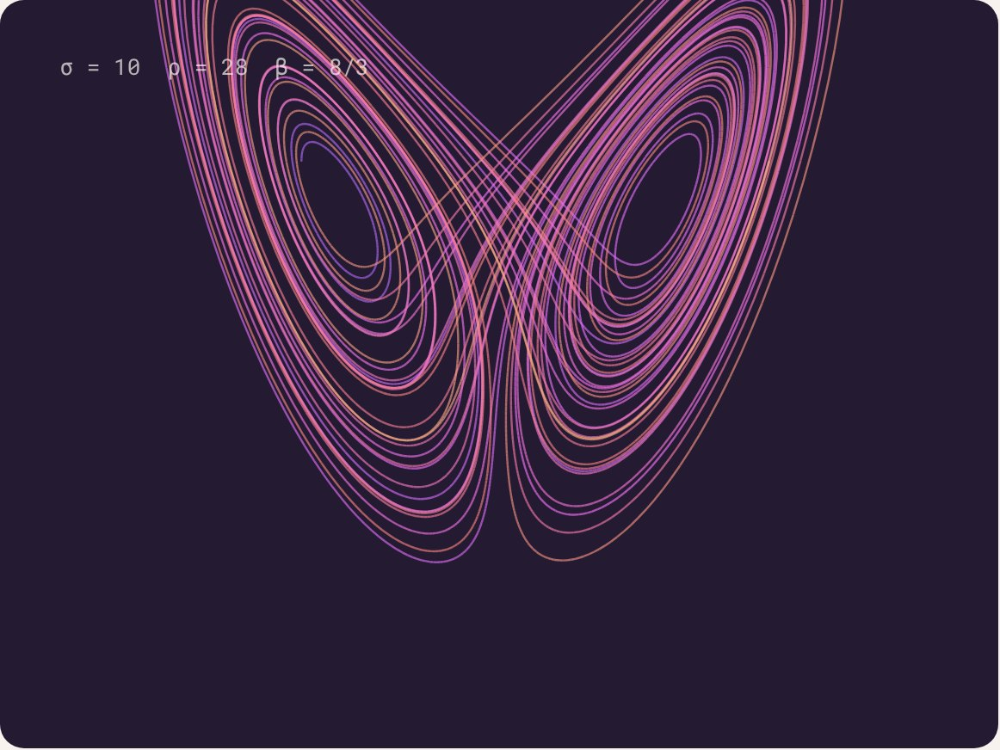</a><br><sub><code>/12</code> &nbsp; <code>ESTUDIOS</code></sub><br><b><a href="#project-2imat">iMAT Year 2</a></b><br>Un año de Ingeniería Matemática e IA: 11 asignaturas, más de 40 trabajos, 8 proyectos finales.</td>
</tr>
<tr>
<td width="50%" valign="top"><a href="#project-mus-stochastic-suite">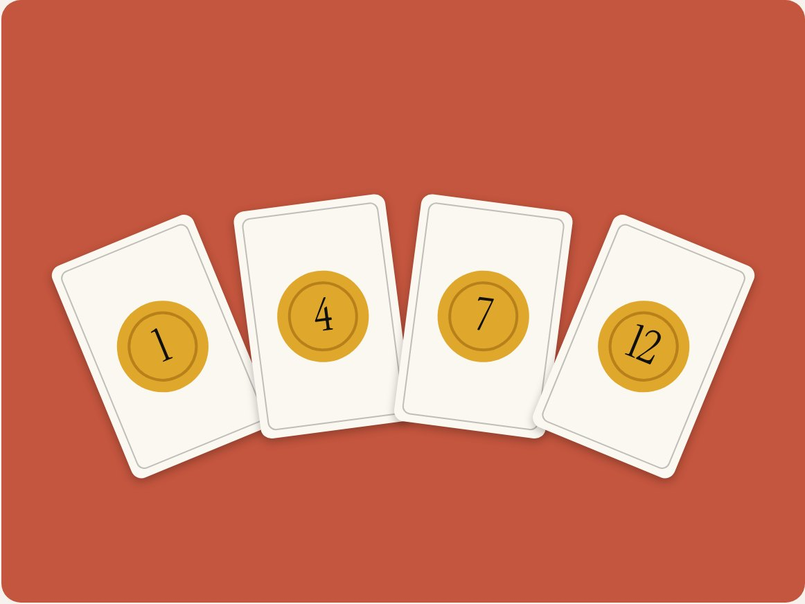</a><br><sub><code>/13</code> &nbsp; <code>CUANTITATIVO Y SIMULACIÓN</code></sub><br><b><a href="#project-mus-stochastic-suite">Mus Suite</a></b><br>En fase inicial: el juego de cartas Mus, con bots y análisis estocástico.</td>
<td width="50%"></td>
</tr>
</table>

**También en GitHub:** [3imat](https://github.com/claudialbombin/3imat) (Trabajos de tercero de iMAT, recién empezado) · [42](https://github.com/claudialbombin/42) (Piscina y cursus: Libft, ft\_printf, get\_next\_line, Born2beRoot (100/100))


<p align="center"></p>

## Qué hago

<table><tr><td width="33%" valign="top"><h3>Modelar</h3>Modelos estocásticos para finanzas y toma de decisiones: Monte Carlo, procesos de decisión de Markov, filtros de partículas y QUBO. Me importa el número y cuánto fiarse de él.</td><td width="33%" valign="top"><h3>Construir</h3>Software que funciona. Python para explorar, C cuando importan la velocidad y la disciplina, aplicaciones web y de escritorio para cosas que la gente usa de verdad. Los motores de aquí se comprueban contra una respuesta conocida.</td><td width="33%" valign="top"><h3>Hablar</h3>Debate, oratoria y mentoría: British Parliamentary, WUDC Panamá 2025, programas de la Embajada de EE. UU. Explicar bien una idea difícil forma parte del trabajo.</td></tr></table>

## En cifras

<table><tr><td width="25%" valign="top"><h1>380/380</h1>decisiones de la tabla de blackjack en las que mi solver Monte Carlo coincide con un solver exacto</td><td width="25%" valign="top"><h1>0.006%</h1>de error de mi pricer Monte Carlo frente a la fórmula cerrada</td><td width="25%" valign="top"><h1>10⁹</h1>rondas simuladas en mi estudio de conteo Hi-Lo</td><td width="25%" valign="top"><h1>3rd</h1>entre todos los equipos hispanohablantes en el Campeonato Mundial Universitario de Debate, Panamá 2025</td></tr></table>


<p align="center"></p>

## Juega con los números

<a href="https://claudialbombin.github.io/">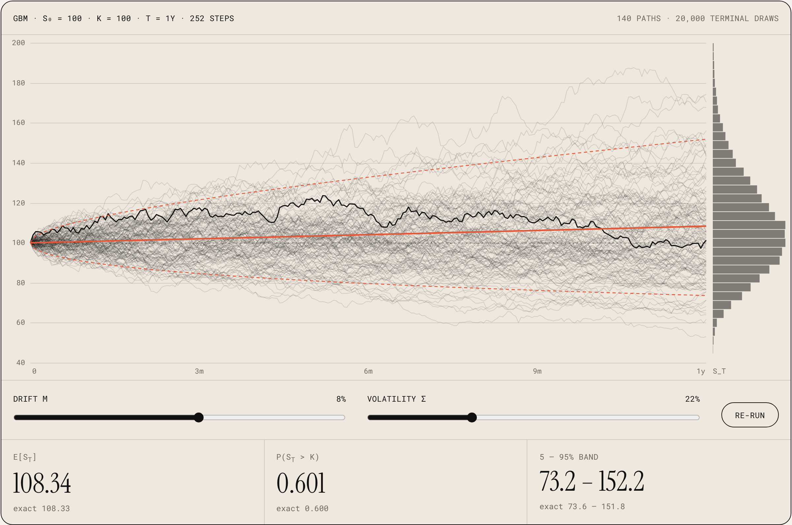</a>

**[Ábrelo en el navegador para mover los controles ↗](https://claudialbombin.github.io/)**

Simulación en vivo. Cada ejecución usa los mismos números aleatorios, así que al mover σ o μ solo cambia lo que cambian los parámetros. La línea central es la media exacta, las discontinuas son los cuantiles exactos del 5% y el 95%, y el histograma de la derecha es la estimación Monte Carlo de S\_T. La misma idea, en pequeño, que mi pricer de opciones y mi filtro de Heston.


<p align="center"></p>

## En el estrado

<table><tr><td width="42%"><br><sub><code>ORATORIA EN LA UNIVERSIDAD PONTIFICIA COMILLAS</code></sub></td><td valign="middle"><h3>El debate me enseñó a estructurar un argumento, defenderlo bajo presión y cambiar de opinión cuando la evidencia lo pide. Compito y juzgo en formatos académico y British Parliamentary, y quedé 3.ª entre todos los equipos hispanohablantes en WUDC Panamá 2025. He hecho mentoría en un programa de la Embajada de EE. UU. y en Technovation Girls. En 42 Madrid cofundé una liga de debate, y he creado CeceCat, un gestor de torneos, para llevar este tipo de eventos.</h3></td></tr></table>


<p align="center"></p>

## Ahora mismo

| | |
|---|---|
| **Propuesta de TFG sobre optimización de carteras con QUBO** | `Quantum annealing y QAOA` |
| **Social Media &amp; Content Creator** | `ICAI · Universidad Pontificia Comillas` |
| **Cursus de 42 Madrid** | `Common Core completado hasta el Rank 02` |
| **Liga de Debate** | `Socia fundadora y formadora, 42 Madrid` |
| **Preparando el CFA** | `A la vez que el grado` |
| **Buscando prácticas para el verano de 2027** | `Quant, datos y software · Londres o Madrid` |

## Últimas novedades en GitHub

| Proyecto | | Fecha |
|---|---|---|
| [**pitwall**](#project-pitwall) | Resultados corregidos en la web, los notebooks y el paper | `nov 2026` |
| [**42**](#project-a-maze-ing) | A-Maze-ing, en Python, y Born2beRoot | `oct 2026` |
| [**salchi-helper**](#project-salchi-helper) | Un salchicha flotante para tu lista de tareas | `oct 2026` |
| [**beat-the-dealer**](#project-beat-the-dealer) | Rehecho: solver exacto, mil millones de rondas, web interactiva | `sep 2026` |
| [**3imat**](https://github.com/claudialbombin/3imat) | Trabajos de tercero de iMAT | `sep 2026` |
| [**cececat**](#project-cececat) | Un gestor de torneos de debate | `sep 2026` |


<p align="center"></p>

## Sobre mí

<table><tr><td width="36%"></td><td valign="middle"><h3>Soy Claudia Lopez, ingeniera nacida en España, especializada en Matemáticas e Inteligencia Artificial.</h3><h3>Tras participar en numerosos proyectos de ingeniería, programas de mentoría y competiciones de debate, decidí centrarme en lo que más me mueve: crear experiencias con sentido e integradoras.</h3><h3>Últimamente eso significa modelos estocásticos para finanzas: Monte Carlo, procesos de Markov, filtrado. Ahora estoy construyendo mi propio enfoque para retos multidisciplinares.</h3></td></tr></table>

Más de 5 años explorando la intersección entre tecnología, datos y experiencias con sentido. Tras vivir experiencias muy distintas de ingeniería, mentoría y debate, decidí seguir mi pasión: explorar nuevas formas de unir tecnología, creatividad e impacto humano. Ahora estoy dando forma a mi propia visión de proyectos con propósito.

**Programas e iniciativas:** Technovation Girls, mentoría de la Embajada de EE. UU., ISC Racing Team, WUDC.

### Cómo trabajo

**Comprobarlo contra algo conocido.** Mi pricer Monte Carlo se valida contra la fórmula cerrada de Black-Scholes. Mi tabla de blackjack se comprueba casilla a casilla con un solver exacto. Si un modelo no se puede comprobar contra algo, aún no me fío de él.

**Escribirlo dos veces.** Python para explorar y ver, C cuando importan la velocidad y la disciplina. El pricer de opciones y el solver de blackjack existen en los dos, y las dos versiones tienen que coincidir.

**Enseñar la incertidumbre.** Errores estándar, tasas de convergencia, un proceso gaussiano que devuelve su propia confianza. Un número sin su barra de error es solo media respuesta. Y cuando un resultado no se sostiene, lo digo: la página de Pitwall cuenta dónde pierde la política.

### Experiencia

**ISC Racing Team** · Cost Report Engineer · Formula Student · `2024 – actualidad`

Gestiono la lista de materiales de un coche de carreras con más de 500 componentes, cumpliendo por completo la normativa de costes. Coordiné 4 subequipos técnicos para alinear el modelado de costes con las restricciones de ingeniería y reduje un 30% las discrepancias en los informes. Contribuí al Engineering Design Report y al Cost Explanation File, con una puntuación en el cuartil superior en las pruebas estáticas.

**Liga de Debate · 42 Madrid** · Socia fundadora y formadora · `2026 – actualidad`

Cofundé la liga y diseñé su gobernanza y su sistema de puntos según el modelo de la Cambridge Union. Dirijo la formación en argumentación y oratoria.

**ICAI · Comillas** · Social Media &amp; Content Creator (prácticas) · `2026 – actualidad`

Planifico, escribo y produzco contenido audiovisual para los canales de ICAI, coordinando las grabaciones con estudiantes.

**CMU Santa María del Pino** · Decana de Cultura · `2024 – actualidad`

Miembro del consejo de gobierno en representación de más de 150 residentes. He organizado más de 10 actividades culturales y profesionales, con más de 200 asistentes.

**Inspire Girls** · `2020 – actualidad`

**Empower Peace** · `2022`

### Formación

| | | |
|---|---|---|
| **ICAI · Comillas** | Grado en Ingeniería Matemática e IA (iMAT) · nota media 7,8/10 | `Previsto mayo 2028` |
| **42 Madrid** | Fundación Telefónica · Common Core completado hasta el Rank 02 · Born2beRoot 100/100 | `Cursus` |
| **Bachillerato e IB** | Bachillerato español (media 10/10) y Bachillerato Internacional | `2023` |

### Idiomas

| | |
|---|---|
| **Español** | Nativo |
| **Inglés** | C2 Cambridge · TOEFL 110 · IELTS 8.0 |
| **Francés** | DELF A2 |

### Debate y liderazgo

| | |
|---|---|
| **WUDC Panama 2025** | 3.ª entre todos los equipos hispanohablantes · más de 200 equipos, más de 50 países |
| **BP Asun Almajano 2025** | Ganadora |
| **Torneo Nacional de Madrid 2024** | Finalista. También finalista en BP Comillas 2024 y BP Carlos III 2025 |
| **BP Regenta 2025** | Jueza de break y de final · más de 100 equipos. Jueza de break en BP Mendel y BP Elías Ahuja 2025 |
| **Technovation Girls** | Embajadora nacional, España, 2020–2024 · más de 100 equipos al año, más de 15 equipos mentorizados |
| **Girl Global Get Ready** | Embajada de EE. UU., 2022–2024 · más de 20 estudiantes mentorizados |

### Habilidades

`Python` `C` `SQL` `JavaScript` `LaTeX` `MATLAB` `NumPy` `Pandas` `scikit-learn` `Jupyter` `Streamlit` `Plotly` `Tableau` `Flask` `Swift` `Electron` `Firestore` `MySQL` `MongoDB` `Neo4j` `SciPy` `matplotlib` `pytest` `GitHub Actions` `Qiskit` `Monte Carlo` `MDP` `Gaussian Processes` `Particle filters` `QUBO`

### Fuera de la pantalla

Me gustan los juegos de mesa y de cartas, y se nota: dos de mis proyectos van de eso. También me importan los pequeños detalles de diseño que hacen que el software se sienta cuidado.


<p align="center"></p>

## Cada proyecto en detalle

Abre un proyecto para leer la pregunta, el método y las cifras. Cada uno tiene también su propia página en la web.

<a id="project-pitwall"></a>
<details>
<summary><code>/01</code> <b>Pitwall</b>: Cuándo parar en boxes en Fórmula 1, resuelto como una opción americana y sin maquillar el resultado.</summary>

<br>


Un optimizador estocástico de estrategia de paradas en boxes para Fórmula 1. Plantea cuándo parar como un proceso de decisión de Markov de horizonte finito resuelto por inducción hacia atrás, con el desgaste de neumáticos modelado con regresión de procesos gaussianos y el riesgo de safety car con un proceso de Poisson bayesiano. Además sigue las sesiones en directo y publica sus recomendaciones por 0 €.

| Tipo | Stack | Métodos |
|---|---|---|
| Proyecto personal | Python · FastF1 · Web | MDP · GPR · Monte Carlo |

[Página en la web ↗](https://claudialbombin.github.io/#/works/pitwall) · [GitHub: pitwall ↗](https://github.com/claudialbombin/pitwall) · [Web del proyecto ↗](https://claudialbombin.github.io/pitwall/)

<table><tr><td valign="top" width="25%"><h2>53%</h2>de 57 comparaciones con estrategias reales de 2023 en las que la política fue más rápida (tiempo modelado)</td><td valign="top" width="25%"><h2>+0.20 s</h2>de delta medio modelado en esas comparaciones</td><td valign="top" width="25%"><h2>48 s</h2>más lenta que una heurística de referencia en la simulación Monte Carlo guardada de Silverstone</td><td valign="top" width="25%"><h2>€0</h2>de coste mensual de la función en directo</td></tr></table>

#### La pregunta

Cada vuelta, un ingeniero de carrera se enfrenta a la misma decisión: ¿parar ahora o seguir con unos neumáticos que se desgastan? Una parada cuesta entre 19 y 24 segundos seguros en el pit lane, según el circuito. Seguir fuera cuesta una pérdida de tiempo incierta que crece con la degradación. Y un safety car puede aparecer en cualquier momento y dejar una parada mala casi gratis.

Las reglas de andar por casa, como “parar sobre la vuelta 25”, ignoran todo eso. Pitwall trata la carrera como lo que es: una decisión secuencial bajo incertidumbre.

#### El modelo

La carrera es un proceso de decisión de Markov. En cada vuelta, el estado recoge:

- el número de vuelta
- el compuesto del neumático (blando, medio, duro, intermedio, lluvia)
- la edad de los neumáticos, en vueltas
- la posición, de 1 a 20
- los huecos discretizados a los coches cercanos
- el número de paradas ya realizadas
- si hay safety car o virtual safety car activo

La acción en cada vuelta es seguir fuera o parar, eligiendo compuesto. El objetivo no es voraz: minimiza el tiempo total esperado de carrera en las vueltas que quedan. La función de valor sale de una ecuación de Bellman resuelta por recursión hacia atrás, que pregunta una sola cosa: ¿compensa más el coste inmediato de parar que el valor esperado de esperar una vuelta más?

#### Neumáticos y safety car

Se ajusta un hazard de Weibull por compuesto para buscar un precipicio de degradación. Los ajustes guardados son débiles, con R² negativo, y no encuentran un precipicio claro. Encima va un proceso gaussiano con kernel Matérn 5/2, para la variación entre circuitos y temperaturas. El modelo devuelve el delta de tiempo por vuelta y su incertidumbre.

```
delta, uncertainty = model.predict(Compound.MEDIUM, tyre_age=22, return_std=True)
```

Los safety cars son un proceso de Poisson no homogéneo para el momento y una distribución geométrica para la duración, con una capa bayesiana que actualiza la tasa de cada circuito a partir de datos históricos.

#### Resultados

Corregí estas cifras en noviembre de 2026 para que la web, los notebooks y el paper coincidan con los resultados guardados. Frente a 57 estrategias reales de pilotos de 2023, en 3 circuitos, la política es más rápida en el 53% de las comparaciones, con una media de 0,20 segundos. Todavía no es una ventaja de estrategia demostrada.

| Circuito | Política más rápida | Delta medio |
|---|---|---|
| Mónaco | 85% | +1.01 s |
| Silverstone | 72% | +0.08 s |
| Monza | 0% | −0.54 s |

En Silverstone el MDP recomendó la vuelta 26. Eso mejoró la vuelta 34 real de Verstappen en 0,41 s y la 32 de Gasly en 0,33 s, pero perdió 0,52 s frente a la vuelta 19 de Leclerc.

- En la simulación Monte Carlo guardada de Silverstone (N = 2.000), el MDP promedia 81,73 minutos frente a 80,93 de la referencia: 48 s más lento.
- Los deltas son modelados, no observados, y cada circuito recibe una sola vuelta recomendada.
- Los intervalos del 90% del safety car cubren solo el 8% de las vueltas.

#### En directo, por 0 €

Un job de GitHub Actions revisa el calendario cada 5 minutos. Cuando hay una sesión en directo, otro job se conecta al mismo feed SignalR de Fórmula 1 en el que se apoya FastF1 y, cada pocos segundos, pregunta al mismo solver que se usa offline qué haría con los huecos, neumáticos y safety car reales. La instantánea va a una rama de git y una página estática la consulta. Sin servidor, sin base de datos y sin feed de pago.

#### La conexión con finanzas

El resultado más interesante es un isomorfismo. Decidir si parar ahora o esperar es el mismo problema que decidir si ejercer una opción americana antes de tiempo: comparar el pago inmediato con el valor esperado de continuar y resolverlo por recursión hacia atrás. La misma maquinaria de la envolvente de Snell de las finanzas cuantitativas se aplica a la estrategia de carrera.

#### Dentro del repo

- core/: formulación del MDP, solver, modelos de neumáticos y safety car, simulador de carrera.
- data/: el pipeline de FastF1. live/: el seguimiento en directo.
- paper/: un documento matemático completo.
- results/: CSV del backtest y gráficos de diagnóstico. tests/: batería de pytest.
- Un sitio estático en GitHub Pages con Simulador, panel en directo, The Math y un Garaje con escenarios animados de paradas.

</details>

<a id="project-beat-the-dealer"></a>
<details>
<summary><code>/02</code> <b>Beat the Dealer</b>: Blackjack resuelto por simulación, comprobado con un solver exacto y contado en mil millones de rondas.</summary>

<br>


Estrategia básica de blackjack derivada por simulación Monte Carlo, comprobada casilla a casilla con un solver exacto, y un estudio del conteo Hi-Lo sobre mil millones de rondas simuladas. Incluye una web interactiva para jugar, practicar y ejecutar las simulaciones.

| Tipo | Stack | Métodos |
|---|---|---|
| Proyecto personal | Python · NumPy · C11 · JavaScript | Monte Carlo · Exact solver · Hi-Lo |

[Página en la web ↗](https://claudialbombin.github.io/#/works/beat-the-dealer) · [GitHub: beat-the-dealer ↗](https://github.com/claudialbombin/beat-the-dealer) · [Web del proyecto ↗](https://claudialbombin.github.io/beat-the-dealer/)

<table><tr><td valign="top" width="25%"><h2>380/380</h2>decisiones de la tabla en las que Monte Carlo coincide con el solver exacto</td><td valign="top" width="25%"><h2>10⁹</h2>rondas simuladas en el estudio de conteo</td><td valign="top" width="25%"><h2>0.696%</h2>de ventaja de la casa con estrategia básica perfecta, ±0,007% (IC 95%)</td><td valign="top" width="25%"><h2>+0.50%</h2>de ventaja ganada por cada +1 de cuenta real Hi-Lo</td></tr></table>

#### Thorp, 1962

Beat the Dealer, de Edward O. Thorp, dio la primera estrategia básica derivada por ordenador y el primer sistema de conteo. Este proyecto rehace ese trabajo con herramientas modernas y comprueba cada paso.

#### Estrategia básica por simulación

Para cada decisión y cada acción legal, el solver simula el resto de la mano 2.000.000 de veces y promedia el beneficio. Dos detalles hacen que sea un solver correcto y no una heurística:

- Inducción hacia atrás: después de pedir, el resto de la mano también debe jugarse de forma óptima, así que los estados se resuelven en un orden en el que ya se conoce todo aquello a lo que puede llevar pedir.
- Números aleatorios comunes: las acciones se comparan contra las mismas manos simuladas del crupier, de modo que la diferencia refleja la decisión y no la suerte del muestreo.

Con vectorización en NumPy y paralelismo por carta del crupier, tarda unos dos minutos.

#### La referencia exacta

Con baraja infinita cada carta es independiente, así que el juego se puede resolver exactamente por recursión. Las 380 casillas coinciden. Tres de ellas (11 contra A, 16 contra 10, 15 blando contra 4) son empates estadísticos con 2M de manos, y el solver exacto confirma la elección de Monte Carlo. El propio solver exacto coincide con la tabla publicada de 6 barajas en todas las casillas salvo 13 blando contra 5, un efecto conocido de retirada de cartas.

#### Cuánto vale contar

Una versión en C11 juega el zapato real de 6 barajas a unos 5 millones de rondas por segundo y por hilo. La conclusión es honesta: contar funciona, pero en este juego la ventaja es pequeña. La cuenta predice muy bien la siguiente mano, pero solo una cuarta parte de las rondas se reparte con cuenta positiva.

| Métrica | Valor |
|---|---|
| Ventaja de la casa, estrategia básica perfecta | 0.696% ± 0.007% |
| Ventaja por cada +1 de cuenta real | +0.50% |
| Cuenta real a partir de la que gana el jugador | ≈ +0.9 |
| Ventaja del contador, apuesta de 1 a 12 | +0.19% |
| Ventaja del contador, apuesta de 1 a 8, dejando la mesa con cuenta negativa | +0.80% |

Límites: el contador nunca se desvía de la tabla, la tabla usa el modelo de baraja infinita, y no se modelan la rendición, volver a dividir ni el seguro.

#### La web

- Jugar: una mesa completa con un entrenador que evalúa cada decisión y muestra el coste en valor esperado de los errores.
- Practicar: decisiones rápidas de dos cartas con sus frecuencias reales y un mapa de dominio.
- Tabla de estrategia: cambia una regla y el juego entero se vuelve a resolver en el navegador.
- Laboratorio Monte Carlo: mira cómo las estimaciones y sus bandas del 95% convergen a la respuesta exacta.
- Conteo: una rampa de apuestas editable, con ventaja, varianza, N0 y riesgo de ruina.

Usa módulos ES sin framework ni compilación. El solver exacto está portado a JavaScript y comprobado con los valores de Python hasta 10⁻⁶. Las implementaciones de Python y C se comprueban entre sí, con integración continua en los tres lenguajes.

</details>

<a id="project-monte-carlo-option-pricer"></a>
<details>
<summary><code>/03</code> <b>Option Pricer</b>: Opciones europeas, asiáticas y con barrera bajo Black-Scholes y Heston, en Python y C.</summary>

<br>


Un motor de valoración de opciones europeas, asiáticas y con barrera bajo dos modelos: Black-Scholes, con volatilidad constante, y Heston, donde la volatilidad es aleatoria. Estima las griegas de tres formas y las compara por varianza. Escrito dos veces, en Python y en C.

| Tipo | Stack | Métodos |
|---|---|---|
| Proyecto personal | Python · C · pytest | Monte Carlo · Black-Scholes · Heston |

[Página en la web ↗](https://claudialbombin.github.io/#/works/monte-carlo-option-pricer) · [GitHub: monte-carlo-option-pricer ↗](https://github.com/claudialbombin/monte-carlo-option-pricer)

<table><tr><td valign="top" width="25%"><h2>0.006%</h2>error relativo con 500K trayectorias frente a la fórmula cerrada</td><td valign="top" width="25%"><h2>77</h2>tests unitarios en Python</td><td valign="top" width="25%"><h2>~6×</h2>menos varianza, griegas pathwise frente a likelihood-ratio</td><td valign="top" width="25%"><h2>2×</h2>más rápido en C que en Python con 500K trayectorias</td></tr></table>

#### Por qué

El proyecto está hecho para mostrar finanzas cuantitativas mediante la implementación y no solo la teoría: aplicar cálculo estocástico, entender cómo converge Monte Carlo, conocer las diferencias entre formas de calcular las griegas y escribir el mismo motor en dos lenguajes. Lo hace todo, de principio a fin.

#### Dos modelos

Black-Scholes supone volatilidad constante. Tiene solución exacta, así que es la verdad contra la que se comprueba todo lo demás. Heston deja que la volatilidad sea aleatoria y revierta a la media:

```
dS = r·S·dt + √v·S·dW¹
dv = κ(θ − v)·dt + ξ·√v·dW²
corr(dW¹, dW²) = ρ
```

- κ = 2,0, la velocidad de reversión a la media
- θ = 0,04, la varianza a largo plazo
- ξ = 0,30, la volatilidad de la volatilidad
- ρ = −0,70, la correlación de apalancamiento

Heston no tiene forma cerrada, así que se simula con un esquema de Euler–Maruyama que absorbe la varianza en cero, con incrementos brownianos correlacionados mediante una descomposición de Cholesky. El sesgo de discretización es lineal en el paso de tiempo; con pasos diarios ronda 0,01–0,02, pequeño frente al error de Monte Carlo.

#### Tres opciones

| Opción | Pago | Precio | Nota |
|---|---|---|---|
| Call europea, forma cerrada | max(S\_T − K, 0) | 10.4506 | verdad de referencia |
| Call europea, Monte Carlo (500K) | max(S\_T − K, 0) | 10.4512 | error del 0,006% |
| Call asiática, media aritmética | max(avg S − K, 0) | 5.8234 | 44,3% más barata que la europea |
| Call con barrera up-and-out, B = 120 | max(S\_T − K, 0) if max S &lt; B | 6.1245 | 41,4% más barata; 23,45% de probabilidad de knock-out |

Promediar reduce la volatilidad efectiva, por eso la opción asiática cuesta menos. La opción con barrera cuesta menos porque puede anularse. Bajo Heston, los precios at-the-money quedan dentro de un ±2% de Black-Scholes; las diferencias crecen en las colas.

#### Convergencia

El error de Monte Carlo cae como 1/√N: diez veces más trayectorias lo dividen por unos 3,16. Los errores estándar medidos siguen casi exactamente la línea teórica.

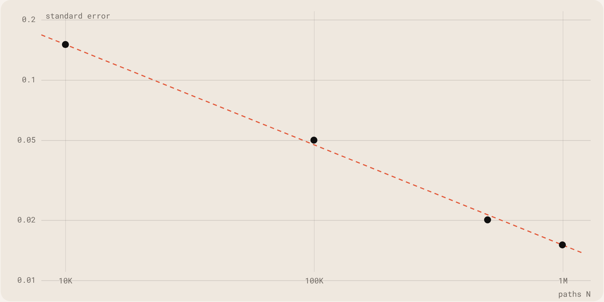

<sub>Error estándar frente a trayectorias, log-log. Puntos: 10K, 100K, 500K y 1M del README. Discontinua: la recta 1/√N por el primer punto.</sub>

#### Griegas, de tres formas

Pathwise deriva el pago: muy poca varianza, pero necesita un pago suave. Likelihood ratio deriva la densidad de probabilidad: sirve para cualquier pago, a costa de más ruido. Las diferencias finitas revaloran dos veces y son la referencia. Frente a la fórmula cerrada de Black-Scholes:

| Método | Delta | Error | Vega | Error |
|---|---|---|---|---|
| Black-Scholes | 0.6368 | – | 37.524 | – |
| Pathwise | 0.6370 | 0.025% | 37.530 | 0.016% |
| Likelihood ratio | 0.6372 | 0.065% | 37.541 | 0.046% |
| Diferencias finitas | 0.6368 | 0.013% | 37.522 | 0.005% |

Pathwise tiene un error estándar de unos 0,0002; likelihood ratio, unos 0,0012, aproximadamente seis veces más. La opción con barrera muestra por qué hacen falta ambos: su pago es discontinuo, así que la estimación pathwise no es fiable, mientras que likelihood ratio da una delta de 0,3452, en línea con las diferencias finitas, en torno a 0,34.

#### Python y C

|  | Python | C |
|---|---|---|
| 500K trayectorias | ~10 s | ~5 s |
| Estilo | orientado a objetos | procedural |
| Dependencias | NumPy, SciPy, Matplotlib | ninguna, solo librería estándar |
| RNG | PCG-64 | Mersenne Twister (MT19937) |
| CDF normal | scipy.stats | Abramowitz &amp; Stegun |
| Memoria | recolector de basura | malloc / free |

- MT19937 en lugar de rand(): periodo de 2^19937−1 frente a 2^31−1, mejores propiedades estadísticas y ejecuciones reproducibles.
- Box–Muller para las normales, guardando la segunda para que cada normal cueste un uniforme de media.
- Memoria manual, porque Heston con muchos pasos necesita unos 800 MB y los arrays en pila no bastan.
- Una aproximación de la CDF normal con error máximo de 7,5×10⁻⁸, muy por debajo del error de Monte Carlo, lo que evita depender de GSL.

#### Tests

La parte de Python tiene 77 tests: 24 para los modelos, 26 para las opciones y 27 para las griegas. La parte de C tiene un modo de test integrado que comprueba resultados con semillas deterministas.

```
cd python && pip install -r requirements.txt && python main.py
cd C && make && make run
```

</details>

<a id="project-salchi-helper"></a>
<details>
<summary><code>/04</code> <b>Salchi</b>: Un salchicha flotante que mantiene tu lista de tareas a la vista, en Mac, Windows y Linux.</summary>

<br>


Mirar tu lista de tareas no debería ser otra tarea. Salchi es un pequeño perro salchicha que se queda encima de todo lo que hay en tu pantalla, tecleando en su portátil. La pegatina del portátil dice cuántas tareas quedan. Pasa el ratón por encima y se abre la lista entera.

| Tipo | Stack | Métodos |
|---|---|---|
| Proyecto personal · publicado | Swift · Electron · Apps Script | Desktop apps · Product design |

[Página en la web ↗](https://claudialbombin.github.io/#/works/salchi-helper) · [GitHub: salchi-helper ↗](https://github.com/claudialbombin/salchi-helper)

<table><tr><td valign="top" width="33%"><h2>3</h2>plataformas: macOS, Windows y Linux</td><td valign="top" width="33%"><h2>2</h2>ediciones: sincronizada con Notion o totalmente local</td><td valign="top" width="33%"><h2>1</h2>vistazo para saber qué queda</td></tr></table>

#### Qué hace

- Flota sobre todas las apps, en todos los escritorios, incluso sobre ventanas a pantalla completa.
- Pasa el ratón para ver la lista; al apartarlo se recoge. Se puede arrastrar a cualquier sitio o dejar la lista fijada.
- Fechas con hora opcional: las vencidas se ponen en rojo, las de hoy en naranja y la lista se ordena sola.
- Las tareas con fecha pueden aparecer en Google Calendar.
- En la edición con Notion, un asistente conectado a tu Notion puede añadirte tareas.

#### Dos ediciones

Cada plataforma viene en dos versiones que comparten todo el código. Con Notion, una base de datos hace de back end y la misma lista llega a todos tus ordenadores y al móvil. Sin Notion, las tareas viven en un pequeño archivo en tu ordenador: sin cuentas, sin configuración y sin que nada salga de la máquina.

#### Cómo está hecho

| Parte | Hecho con | En resumen |
|---|---|---|
| Mac | Swift, SwiftUI, AppKit | Un panel sin bordes que nunca roba el foco, más un contador en la barra de menús |
| Windows · Linux | Electron | Un solo código, empaquetado como instalador, AppImage y .deb |
| Calendar | Google Apps Script | Copia las tareas con fecha de Notion en Google Calendar |

- La app habla con una única interfaz de tareas con dos implementaciones; la edición se elige al empaquetar.
- Actualizaciones optimistas: la pantalla cambia al instante, el guardado va en segundo plano y se revierte si falla.
- Un hover que nunca se queda atascado: la ventana cambia de tamaño bajo el cursor, así que las apps vigilan ellas mismas su posición.
- Los tests de extremo a extremo manejan la interfaz real de escritorio contra un Notion falso.

</details>

<a id="project-cececat"></a>
<details>
<summary><code>/05</code> <b>CeceCat</b>: Un gestor de torneos de debate que funciona entero desde una sola página web.</summary>

<br>


Un gestor de torneos de debate por parejas. Crea el torneo con un asistente guiado, genera los emparejamientos de cada ronda, reparte a los jueces, recoge las puntuaciones a mano o en directo desde el móvil de cada juez y lleva la clasificación. No hay servidor que mantener ni nada que instalar: index.html es un solo archivo.

| Tipo | Stack | Métodos |
|---|---|---|
| Proyecto personal | JavaScript · Firestore · EmailJS | Pairing · Assignment |

[Página en la web ↗](https://claudialbombin.github.io/#/works/cececat) · [GitHub: cececat ↗](https://github.com/claudialbombin/cececat) · [Web del proyecto ↗](https://claudialbombin.github.io/cececat/)

<table><tr><td valign="top" width="25%"><h2>2</h2>formatos: académico y British Parliamentary</td><td valign="top" width="25%"><h2>6</h2>pasos para crear un torneo</td><td valign="top" width="25%"><h2>3</h2>capas de copia de seguridad</td><td valign="top" width="25%"><h2>1</h2>archivo HTML contiene toda la aplicación</td></tr></table>

#### Por qué

Compito en debate, y llevar un torneo significa emparejamientos, salas, jueces y puntuaciones con prisa. CeceCat lo pone todo en una página que sigue funcionando sin conexión. Las dos partes opcionales, puntuaciones en directo y correos a los jueces, simplemente no se activan si no se configuran.

#### Jueces que rotan de verdad

En cada ronda, el algoritmo compara todas las combinaciones posibles de sala y juez y se queda con la que menos repite. No decide sala por sala en un orden fijo, así que quién comparte mesa cambia de verdad de una ronda a otra.

- Un juez en prácticas nunca preside una sala si hay otro juez disponible.
- Evita repetir parejas de jueces y que un juez vea dos veces al mismo equipo.
- Se repara sola: tras recargar o importar una copia antigua, reconstruye el historial de cada juez a partir de las rondas ya jugadas.

#### Emparejamientos y puntuaciones

Las rondas se emparejan por clasificación, evitan repetir rivales cuando es posible y equilibran quién ha ocupado cada posición. Cada juez recibe un solo enlace para todo el torneo. Solo quien preside puede enviar la puntuación desde él, y la mesa central siempre la revisa antes de que cuente.

#### No se pierde nada

- Guardado automático en el navegador con cada cambio.
- Una copia .json descargable para seguir en otro ordenador y un informe .txt legible.
- Copias automáticas por ronda en una carpeta del disco, con la File System Access API en navegadores Chromium.

También importa PDF sin conexión, con una librería integrada.

</details>

<a id="project-scm-heston-filter"></a>
<details>
<summary><code>/06</code> <b>Heston Filter</b>: Un filtro de partículas que sigue una volatilidad que nadie observa.</summary>

<br>


Un filtro de partículas que sigue la volatilidad, que nadie observa, a partir de los precios, que llevan ruido. Implementa Monte Carlo secuencial sobre el modelo de volatilidad estocástica de Heston.

| Tipo | Stack | Métodos |
|---|---|---|
| Proyecto personal | Python | Sequential Monte Carlo · Heston |

[Página en la web ↗](https://claudialbombin.github.io/#/works/scm-heston-filter) · [GitHub: scm-heston-filter ↗](https://github.com/claudialbombin/scm-heston-filter)

#### El problema

En el modelo de Heston la volatilidad no es un número que se pueda consultar. Es un estado oculto que se mueve al azar y que solo se ve a través de los precios, que llevan ruido. Para valorar una opción o medir riesgo hace falta igualmente. La pregunta es cómo recuperar una cantidad que se mueve y no se observa a partir de observaciones ruidosas.

#### El modelo

```
dS = r·S·dt + √v·S·dW¹
dv = κ(θ − v)·dt + ξ·√v·dW²
corr(dW¹, dW²) = ρ
```

El precio sigue una ecuación y su varianza v sigue otra, correlacionada con la primera. Solo se observa el precio.

#### El método

Un filtro de partículas mantiene una nube de hipótesis sobre la varianza oculta, las partículas. En cada paso, cada partícula avanza con la dinámica del modelo y se pondera según lo bien que explica el precio observado. Después se remuestrea la nube para que las buenas hipótesis se multipliquen y las malas desaparezcan. El resultado es una estimación continua de la volatilidad latente, con su incertidumbre, que se actualiza con cada precio nuevo.

#### En este repo

Una implementación en Python de ese filtro sobre el modelo de Heston, con licencia MIT. Es la compañera de mi pricer de opciones: el pricer simula Heston hacia delante, el filtro trabaja hacia atrás desde los datos.

</details>

<a id="project-tfg"></a>
<details>
<summary><code>/07</code> <b>QUBO Thesis</b>: Selección de carteras como un problema que un quantum annealer puede leer.</summary>

<br>


Propuesta de TFG sobre formulaciones QUBO de optimización de carteras con restricción de cardinalidad: mantener solo k activos de entre muchos. Une matemática discreta, quantum annealing en D-Wave y QAOA en Qiskit con finanzas cuánticas.

| Tipo | Stack | Métodos |
|---|---|---|
| Propuesta de TFG · en curso | LaTeX · Qiskit · D-Wave | QUBO · Quantum annealing · QAOA |

[Página en la web ↗](https://claudialbombin.github.io/#/works/tfg)

#### El problema

La teoría de carteras de Markowitz dice cómo ponderar activos. Los inversores reales también quieren tener solo unos pocos: k de entre cientos. Esa restricción de cardinalidad convierte una optimización suave en una combinatoria, que en general es NP-difícil.

#### La idea

Un QUBO, optimización binaria cuadrática sin restricciones, pide el vector binario x que minimiza xᵀQx. Cada variable binaria dice si un activo está en la cartera. El riesgo y el retorno esperado pasan a ser entradas de Q, y la restricción de cardinalidad se incorpora como una penalización que crece cuando el número de activos elegidos no es k. Cuando un problema es un QUBO, se puede entregar a hardware que habla ese lenguaje.

```
min  xᵀQx      x ∈ {0,1}ⁿ
penalty:  λ · (Σ xᵢ − k)²
```

#### Dos rutas cuánticas

- Quantum annealing en D-Wave, hardware pensado para minimizar justo este tipo de función de energía.
- QAOA en Qiskit, el algoritmo variacional para ordenadores cuánticos de puertas.

#### Estado

La propuesta de investigación está cerrada y redactada como un documento completo en LaTeX. El TFG va de 2026 a 2028.

</details>

<a id="project-pause"></a>
<details>
<summary><code>/08</code> <b>Pause</b>: Un ejercicio de respiración antes de las apps que no puedes soltar.</summary>

<br>


Una capa de fricción consciente para apps adictivas. Antes de Instagram, TikTok, YouTube o la app que elijas, abre un breve ejercicio de respiración. Rompe el bucle de hábito automático sin bloquear nada.

| Tipo | Stack | Métodos |
|---|---|---|
| Proyecto personal | HTML · JavaScript | Product design |

[Página en la web ↗](https://claudialbombin.github.io/#/works/pause) · [GitHub: pause ↗](https://github.com/claudialbombin/pause) · [Web del proyecto ↗](https://claudialbombin.github.io/pause/)

#### El problema

La mayoría de las veces no decides abrir Instagram; lo hace tu pulgar. El bucle del hábito funciona en piloto automático: disparador, abrir, hacer scroll.

#### La idea

Pause añade un poco de fricción justo en ese momento. Antes de Instagram, TikTok, YouTube o la app que elijas, abre un breve ejercicio de respiración. No se bloquea nada; la idea es darte una respiración para decidir.

- Fricción en vez de bloqueo, para interrumpir el hábito sin pelearse con quien lo usa.
- Tú eliges qué apps lo activan.

#### Por dentro

Hecho con HTML y JavaScript puros. El repositorio incluye un manifiesto de aplicación web, de modo que puede comportarse como una app instalable.

</details>

<a id="project-recetario-familiar"></a>
<details>
<summary><code>/09</code> <b>Recetario</b>: Un recetario familiar acogedor con tapa que se abre, en la web.</summary>

<br>


Un recetario acogedor para la familia, hecho como aplicación web y desplegado en GitHub Pages: un libro que se abre, pasa sus páginas y ajusta cada receta al número de comensales.

| Tipo | Stack | Métodos |
|---|---|---|
| Proyecto personal | HTML · CSS · JavaScript | Web app · UI design |

[Página en la web ↗](https://claudialbombin.github.io/#/works/recetario-familiar) · [GitHub: recetario-familiar ↗](https://github.com/claudialbombin/recetario-familiar) · [Web del proyecto ↗](https://claudialbombin.github.io/recetario-familiar/)

#### La idea

Un lugar donde vivan las recetas de la familia, que se sienta hecho a mano y no como un software. El aspecto viene de un bolso de tela con rayas bordadas: rayas burdeos y crudo, bordes de punto de cruz, bordados florales y detalles de cuero, traducidos a un recetario digital.

#### Qué hace

- Una animación 3D de apertura de libro con cambio de página y doble página, que pasa a una sola página continua en el móvil.
- Añadir, editar y borrar recetas, con subida de fotos y compresión de imagen en el navegador.
- Capítulos y categorías que se pueden añadir, renombrar y borrar.
- Nivel de picante de 1 a 5 guindillas, marcas de vegano y vegetariano y etiquetas libres.
- Un escalador de raciones que recalcula las cantidades de los ingredientes de forma proporcional.
- Búsqueda por título, ingredientes, categoría y etiquetas, y filtro por dieta y capítulo.

#### Cómo está hecho

Un único index.html sin paso de compilación, desplegado en GitHub Pages, con las recetas guardadas en el navegador. El libro de doble página necesitó detección de viewport con JavaScript, porque solo con CSS no se podían servir bien los diseños de móvil y de escritorio. Los diálogos nativos del navegador se sustituyeron por modales propios. Pasó de la primera idea a un producto desplegado en una larga sesión de trabajo.

</details>

<a id="project-a-maze-ing"></a>
<details>
<summary><code>/10</code> <b>A-Maze-ing</b>: Un generador de laberintos reproducible con un “42” en el centro, en Python, en 42 Madrid.</summary>

<br>


Un generador de laberintos escrito en pareja para el currículo de 42 Madrid. Lee un archivo de configuración, genera un laberinto que siempre es el mismo para la misma semilla, lo escribe en un archivo con un dígito hexadecimal por celda y lo dibuja en la terminal en color.

| Tipo | Stack | Métodos |
|---|---|---|
| Curso · 42 Madrid | Python · flake8 · mypy | Graph algorithms |

[Página en la web ↗](https://claudialbombin.github.io/#/works/a-maze-ing) · [GitHub: 42/A-maze-ing ↗](https://github.com/claudialbombin/42/tree/main/Cursus/Rank02/A-maze-ing)

#### Dos tipos de laberinto

- Perfecto: exactamente un camino entre la entrada y la salida, sin bucles.
- No perfecto: un tablero para un juego tipo Pac-Man, con muchos bucles y sin más callejones que los que cierra el “42”.

#### El algoritmo

Por defecto usa un backtracker recursivo, una búsqueda en profundidad aleatoria que produce un árbol generador de las celdas, y eso es lo que hace perfecto al laberinto. Usa una lista como pila y no recursión real, porque Python llega a su límite de recursión con laberintos grandes. El algoritmo de Prim está disponible como opción.

#### Detalles

- El generador es un paquete aparte, mazegen, empaquetado como wheel para reutilizarlo en otro proyecto.
- Un menú regenera el laberinto, muestra el camino más corto y rota los colores.
- Una configuración errónea siempre termina con un mensaje claro, nunca con un traceback.

</details>

<a id="project-push-swap"></a>
<details>
<summary><code>/11</code> <b>push_swap</b>: Ordenar con dos pilas y un puñado de movimientos, en C, en 42 Madrid.</summary>

<br>


El proyecto push\_swap del currículo de C de 42 Madrid: ordenar una pila de enteros usando una segunda pila y un conjunto muy pequeño de operaciones, con el menor número de movimientos posible. Hecho en pareja, en una variante que elige su estrategia según lo desordenada que esté la entrada. Terminado, con el checker bonus.

| Tipo | Stack | Métodos |
|---|---|---|
| Curso · 42 Madrid | C | Sorting · Complexity |

[Página en la web ↗](https://claudialbombin.github.io/#/works/push-swap) · [GitHub: 42/push\_swap ↗](https://github.com/claudialbombin/42/tree/main/Cursus/Rank01/push_swap)

#### El ejercicio

Es un problema de ordenación donde el coste no es el tiempo sino el número de operaciones. Solo se puede pasar de una pila a otra, intercambiar y rotar, así que cada algoritmo se juzga por cuántos movimientos imprime.

#### Esta versión

Un índice de desorden, calculado contando inversiones, mide lo lejos que está la entrada de estar ordenada. Un modo adaptativo lo usa para elegir la estrategia. Cada una también se puede forzar con una opción, y un modo benchmark informa del índice, la estrategia y las operaciones por tipo.

| Opción | Estrategia | Clase |
|---|---|---|
| --simple | Por selección | O(n²) |
| --medium | Por bloques | O(n√n) |
| --complex | Radix LSD | O(n log n) |
| --adaptive | Elige una de las anteriores | según la entrada |

Las entradas de hasta 5 números usan una ordenación óptima por búsqueda exhaustiva. Mi compañero escribió el módulo de parseo.

#### Las reglas del juego

La Norma de 42 limita cómo puede ser el código:

- Máximo 25 líneas por función, 5 funciones por archivo y 4 parámetros por función.
- Sin bucles for ni operadores ternarios.
- Sin variables globales: la estructura del benchmark se pasa por puntero a través de todas las funciones.

</details>

<a id="project-2imat"></a>
<details>
<summary><code>/12</code> <b>iMAT Year 2</b>: Un año de Ingeniería Matemática e IA: 11 asignaturas, más de 40 trabajos, 8 proyectos finales.</summary>

<br>


El repositorio de mi segundo curso de Ingeniería Matemática e IA en ICAI: 11 asignaturas, más de 40 trabajos y 8 proyectos finales, en abierto en un solo repositorio.

| Tipo | Stack | Métodos |
|---|---|---|
| Curso · ICAI | Python · MATLAB · C · SQL | ML · Databases · Numerical methods |

[Página en la web ↗](https://claudialbombin.github.io/#/works/2imat) · [GitHub: 2imat ↗](https://github.com/claudialbombin/2imat)

<table><tr><td valign="top" width="25%"><h2>11</h2>asignaturas</td><td valign="top" width="25%"><h2>40+</h2>trabajos</td><td valign="top" width="25%"><h2>8</h2>proyectos finales</td><td valign="top" width="25%"><h2>474K</h2>reseñas de Amazon en el proyecto del recomendador</td></tr></table>

#### Las asignaturas

Adquisición de datos, Machine Learning, Bases de datos, Cognición humana e IA, Ecuaciones diferenciales, Fundamentos de IA, Sistemas operativos, Matemática discreta, Métodos numéricos, Sistemas electrónicos y Visualización de datos.

#### Proyectos que merece la pena abrir

- Un sistema de recomendación híbrido sobre 474K reseñas de Amazon, repartidas en tres tipos de base de datos, con un panel interactivo.
- Una reproducción del fallo del Ariane 5, que muestra cómo un desbordamiento en coma flotante derriba un cohete.
- El sistema de Lorenz y el oscilador de Van der Pol: caos y ciclos límite, visualizados.
- Predicción del éxito de estudiantes con varios algoritmos de clasificación.
- Rutas de camino más corto tipo GPS sobre la red real de calles de Madrid.
- Un panel de sensores con Raspberry Pi controlado por Bluetooth.

#### Herramientas

Python, MATLAB, C y Bash; scikit-learn, NumPy y pandas; MySQL, MongoDB y Neo4j; Plotly y Flask; y una Raspberry Pi.

</details>

<a id="project-mus-stochastic-suite"></a>
<details>
<summary><code>/13</code> <b>Mus Suite</b>: En fase inicial: el juego de cartas Mus, con bots y análisis estocástico.</summary>

<br>


Una suite planificada para el juego de cartas Mus: jugable contra bots, con tutorial y dos motores de análisis estocástico, en Python y C, para modelar la estrategia. Está en fase inicial y, por ahora, el repositorio solo recoge el plan.

| Tipo | Stack | Métodos |
|---|---|---|
| Proyecto personal · fase inicial | Python · C (planned) | Simulation · Game analysis |

[Página en la web ↗](https://claudialbombin.github.io/#/works/mus-stochastic-suite) · [GitHub: mus-stochastic-suite ↗](https://github.com/claudialbombin/mus-stochastic-suite)

#### El juego

El mus es un juego de cartas español que se juega por parejas con la baraja española de 40 cartas. Cada mano se apuesta en cuatro lances: grande, chica, pares y juego. Mezcla probabilidad con farol y con comunicación entre compañeros, lo que lo hace un buen tema para simular.

#### El plan

- Multijugador local y partida en solitario contra bots de dificultad ajustable.
- Un tutorial guiado para principiantes.
- Una extensión en la nube para jugar online.
- Dos motores, en Python y C, que simulan miles de partidas para modelar estrategias óptimas.

</details>

<sub>Las portadas de los proyectos, salvo la de Salchi, las genera la web para ilustrar cada idea. No son resultados de los proyectos.</sub>


<p align="center"></p>

## Contacto

<a href="mailto:claudialbombin@gmail.com">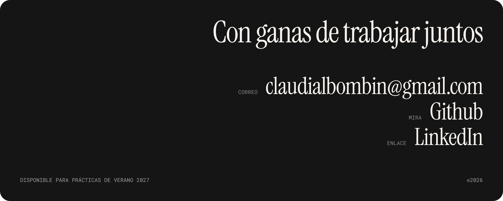</a>

**Correo:** [claudialbombin@gmail.com](mailto:claudialbombin@gmail.com) · **GitHub:** [claudialbombin](https://github.com/claudialbombin) · **LinkedIn:** [claudia-lopez-bombin](https://www.linkedin.com/in/claudia-lopez-bombin) · **Web:** [claudialbombin.github.io](https://claudialbombin.github.io/)

`DISPONIBLE PARA PRÁCTICAS DE VERANO 2027`

### Sobre este repositorio

Este repositorio es el código de la web. Es un único `index.html` estático y bilingüe, sin framework ni compilación, y GitHub Pages lo sirve tal cual.

**Qué hay aquí**

```
index.html         toda la web: contenido, estilos y scripts
assets/            fotos y portada de Salchi
assets/readme/     imágenes que solo usa este README
.nojekyll          indica a GitHub Pages que sirva los archivos tal cual
README.md          versión en inglés
README.es.md       este archivo, en español
```

**Ejecutarlo en local**

```bash
git clone https://github.com/claudialbombin/claudialbombin.github.io.git
cd claudialbombin.github.io
python3 -m http.server 8000
# http://localhost:8000
```
