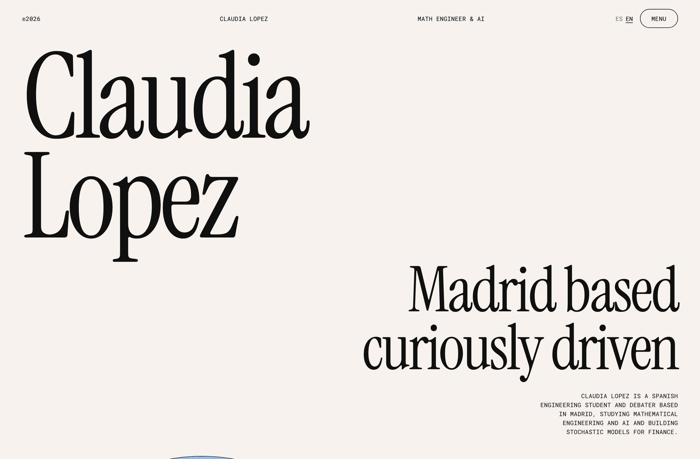
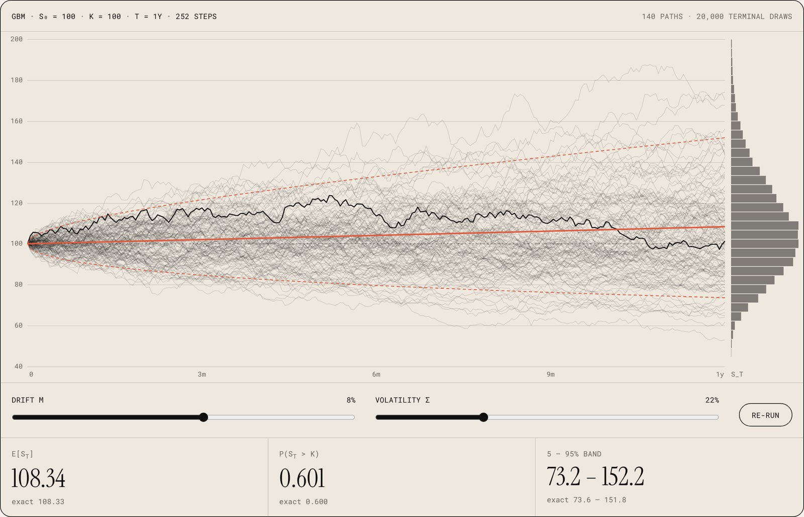
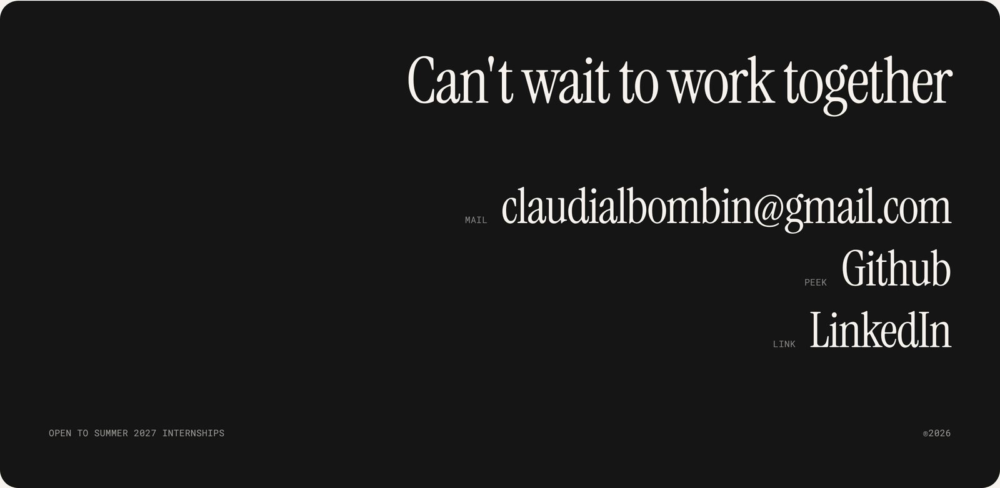

<a href="https://claudialbombin.github.io/"></a>

<p align="center">
  <b><a href="https://claudialbombin.github.io/">▶ Visit the live site</a></b> &nbsp;·&nbsp; <b>English</b> · <a href="README.es.md">Español</a>
</p>

# claudialbombin.github.io

My personal portfolio: thirteen projects in quantitative modelling, simulation and software, each with its own page that states the question, the method, the numbers and the limitations. It is bilingual (English and Spanish) and runs as a single static HTML file on GitHub Pages.

The projects themselves live in their own repositories. This repo is only the site; for the project list, see the [live site](https://claudialbombin.github.io/#/works) or my [GitHub profile](https://github.com/claudialbombin).

## What is worth looking at

- **One file, no build.** All of the content, styles and scripts live in `index.html`: plain JavaScript, no framework, no bundler and no dependencies beyond three Google Fonts. Pages serve it as it is.
- **A hash router.** Every view has a URL (`#/works/pitwall`, `#/about`), so deep links and the back button work on GitHub Pages without any 404 fallback.
- **Bilingual by construction.** Every string is an `{ en, es }` pair, so a missing translation shows up as a gap in the data rather than a stray English sentence. The language choice is remembered in `localStorage`.
- **A live Monte Carlo lab.** "Play with the numbers" simulates geometric Brownian motion on a canvas. It reuses the same random draws on every run (common random numbers), so moving the drift or volatility sliders only changes what the parameters change. The exact mean and quantiles are drawn alongside the estimates, so you can watch the simulation agree with the closed form.
- **Generated cover art.** Project covers are drawn on canvas from a seeded generator (an FNV-1a hash feeding a mulberry32 PRNG). Each cover is deterministic per project, costs no image bytes and is labelled on the page as an illustration, not project output.
- **"Recently on GitHub" is live.** One unauthenticated call to the GitHub API, cached for an hour. If the API is unreachable or rate-limited, a hand-written list is shown instead.
- **Accessibility.** Respects `prefers-reduced-motion`, uses real headings and labelled controls, and photos fail gracefully without leaving broken frames.

<a href="https://claudialbombin.github.io/"></a>

## Run it locally

```bash
git clone https://github.com/claudialbombin/claudialbombin.github.io.git
cd claudialbombin.github.io
python3 -m http.server 8000      # then open http://localhost:8000
```

Opening `index.html` directly also works; the local server only matters for the GitHub feed.

## Structure

```
index.html        the whole site: content, styles and scripts
assets/           photos used by the site
assets/readme/    screenshots used only by these READMEs
.nojekyll         tells GitHub Pages to serve the files as they are
README.md         this file (README.es.md is the Spanish version)
```

## Editing content

Everything the site says lives in data near the top of the script inside `index.html`:

| To change… | Edit |
|---|---|
| A project page | its entry in `P` (`slug`, `name`, `repo`, `cat`, `short`, `lead`, `figs`, `secs`). Pages are rendered from these fields. |
| Interface text | the `T` object (every key holds `{ en, es }`) |
| "Right now" | `T.now` |
| The fallback for "Recently on GitHub" | `RECENT` (its blurbs also replace repo descriptions in the live list) |

## Deployment

GitHub Pages builds from the root of `main`. A push is live within a minute or two.

## Contact

<a href="mailto:claudialbombin@gmail.com"></a>

[claudialbombin@gmail.com](mailto:claudialbombin@gmail.com) · [GitHub](https://github.com/claudialbombin) · [LinkedIn](https://www.linkedin.com/in/claudia-lopez-bombin) · Open to summer 2027 internships.
