<a href="https://claudialbombin.github.io/"></a>

<p align="center"><b><a href="#my-works">Works</a></b> &nbsp;/&nbsp; <b><a href="#about">About</a></b> &nbsp;/&nbsp; <b><a href="#contact">Contact</a></b> &nbsp;/&nbsp; <b><a href="https://claudialbombin.github.io/">Visit the live site ↗</a></b></p>

<p align="center"><b>English</b> · <a href="README.es.md">Español</a></p>

> **Madrid based, curiously driven.** Claudia Lopez is a Spanish engineer and speaker based in Madrid, studying Mathematical Engineering and AI and building stochastic models for finance.


<p align="center"></p>

## My works

Simulation, stochastic modelling and software, from coursework to things I built because I wanted them to exist. Every project has its own page with the question, the method and the numbers.

<table>
<tr>
<td width="50%" valign="top"><a href="#project-pitwall">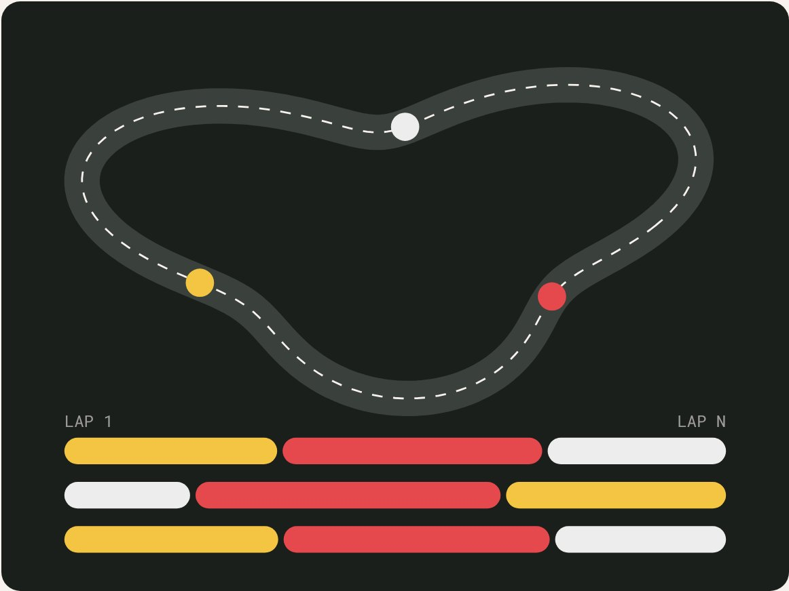</a><br><sub><code>/01</code> &nbsp; <code>QUANT & SIMULATION</code></sub><br><b><a href="#project-pitwall">Pitwall</a></b><br>When to pit in Formula 1, solved like an American option, and honest about the result.</td>
<td width="50%" valign="top"><a href="#project-beat-the-dealer">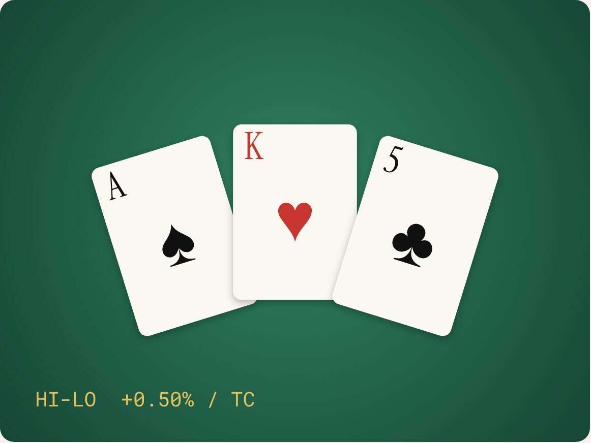</a><br><sub><code>/02</code> &nbsp; <code>QUANT & SIMULATION</code></sub><br><b><a href="#project-beat-the-dealer">Beat the Dealer</a></b><br>Blackjack solved by simulation, checked against an exact solver, and counted over a billion rounds.</td>
</tr>
<tr>
<td width="50%" valign="top"><a href="#project-monte-carlo-option-pricer">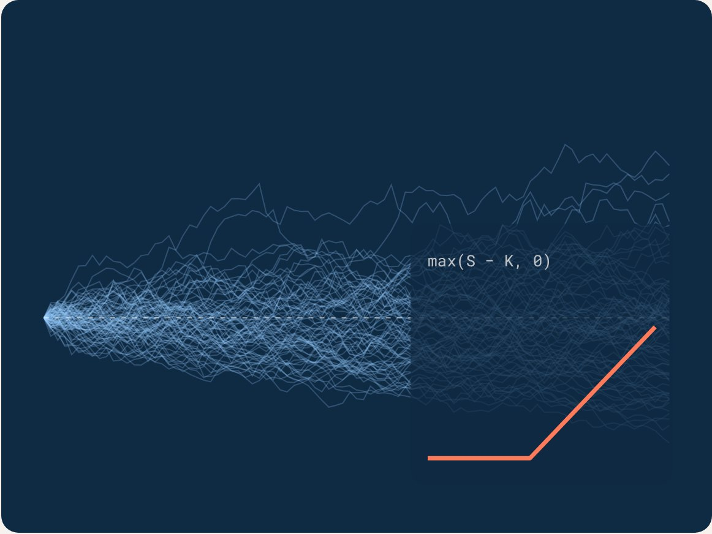</a><br><sub><code>/03</code> &nbsp; <code>QUANT & SIMULATION</code></sub><br><b><a href="#project-monte-carlo-option-pricer">Option Pricer</a></b><br>European, Asian and barrier options under Black-Scholes and Heston, in Python and C.</td>
<td width="50%" valign="top"><a href="#project-salchi-helper">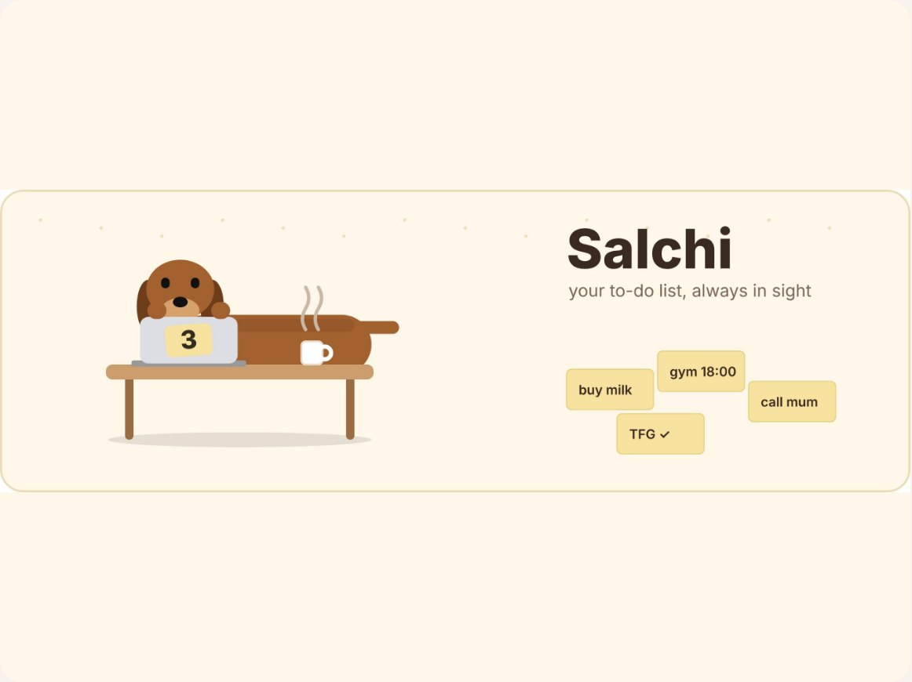</a><br><sub><code>/04</code> &nbsp; <code>SOFTWARE</code></sub><br><b><a href="#project-salchi-helper">Salchi</a></b><br>A floating dachshund that keeps your to-do list in sight, on Mac, Windows and Linux.</td>
</tr>
<tr>
<td width="50%" valign="top"><a href="#project-cececat">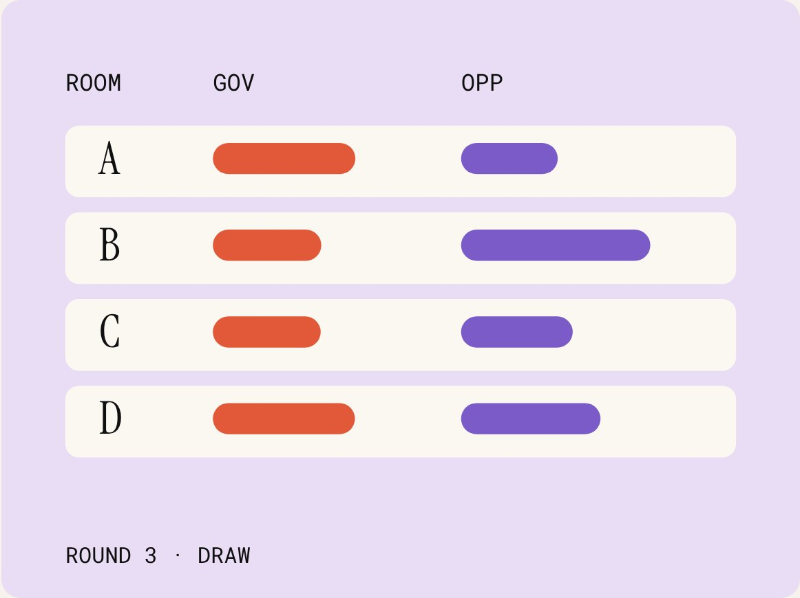</a><br><sub><code>/05</code> &nbsp; <code>SOFTWARE</code></sub><br><b><a href="#project-cececat">CeceCat</a></b><br>A debate tournament manager that runs entirely from one web page.</td>
<td width="50%" valign="top"><a href="#project-scm-heston-filter">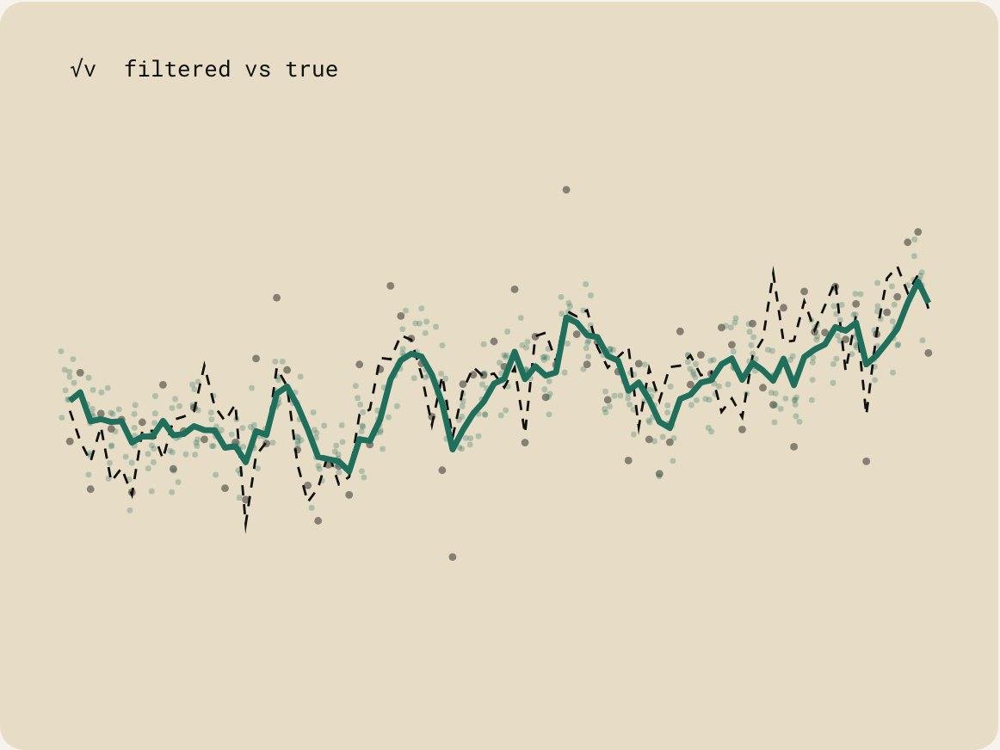</a><br><sub><code>/06</code> &nbsp; <code>QUANT & SIMULATION</code></sub><br><b><a href="#project-scm-heston-filter">Heston Filter</a></b><br>A particle filter that tracks a volatility nobody can observe.</td>
</tr>
<tr>
<td width="50%" valign="top"><a href="#project-tfg">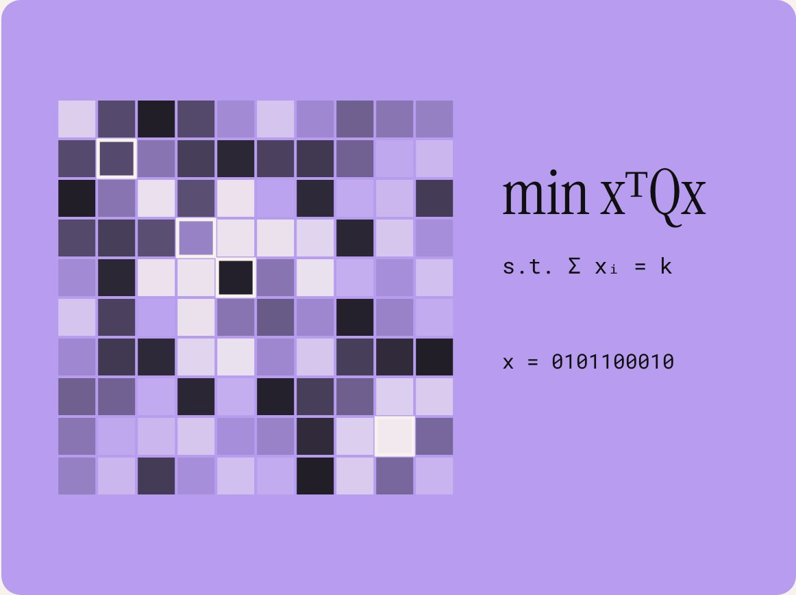</a><br><sub><code>/07</code> &nbsp; <code>QUANT & SIMULATION</code></sub><br><b><a href="#project-tfg">QUBO Thesis</a></b><br>Portfolio selection as a problem quantum annealers can read.</td>
<td width="50%" valign="top"><a href="#project-pause"></a><br><sub><code>/08</code> &nbsp; <code>SOFTWARE</code></sub><br><b><a href="#project-pause">Pause</a></b><br>A breathing exercise before the apps you cannot put down.</td>
</tr>
<tr>
<td width="50%" valign="top"><a href="#project-recetario-familiar"></a><br><sub><code>/09</code> &nbsp; <code>SOFTWARE</code></sub><br><b><a href="#project-recetario-familiar">Recetario</a></b><br>A cozy family recipe book with a page-turning cover, on the web.</td>
<td width="50%" valign="top"><a href="#project-a-maze-ing">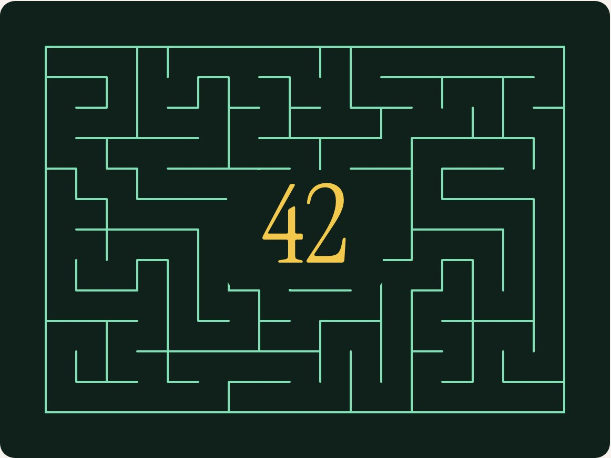</a><br><sub><code>/10</code> &nbsp; <code>SOFTWARE</code></sub><br><b><a href="#project-a-maze-ing">A-Maze-ing</a></b><br>A reproducible maze generator with a “42” in the middle, in Python, at 42 Madrid.</td>
</tr>
<tr>
<td width="50%" valign="top"><a href="#project-push-swap">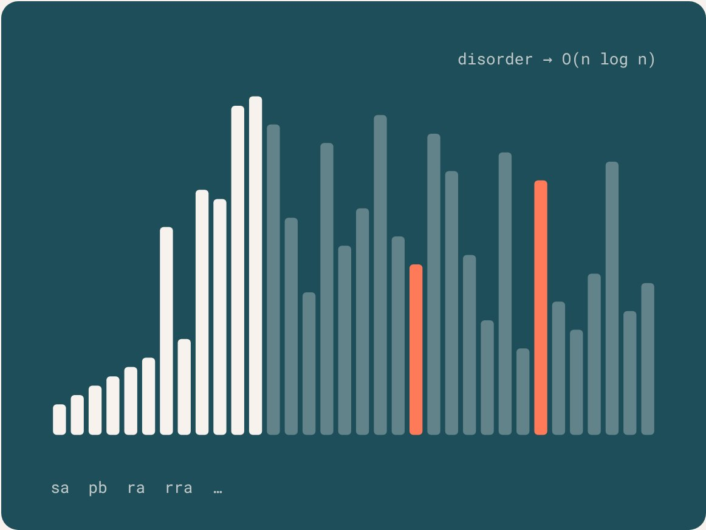</a><br><sub><code>/11</code> &nbsp; <code>SOFTWARE</code></sub><br><b><a href="#project-push-swap">push_swap</a></b><br>Sorting with two stacks and a handful of moves, in C, at 42 Madrid.</td>
<td width="50%" valign="top"><a href="#project-2imat">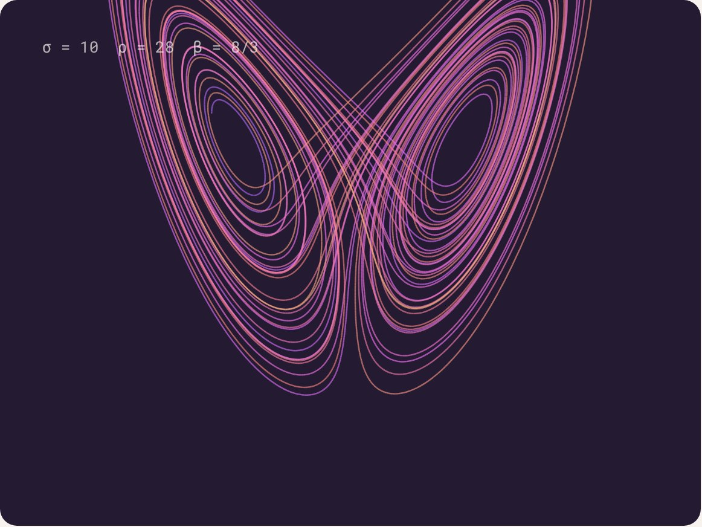</a><br><sub><code>/12</code> &nbsp; <code>COURSEWORK</code></sub><br><b><a href="#project-2imat">iMAT Year 2</a></b><br>A year of Mathematical Engineering and AI: 11 courses, 40+ assignments, 8 final projects.</td>
</tr>
<tr>
<td width="50%" valign="top"><a href="#project-mus-stochastic-suite">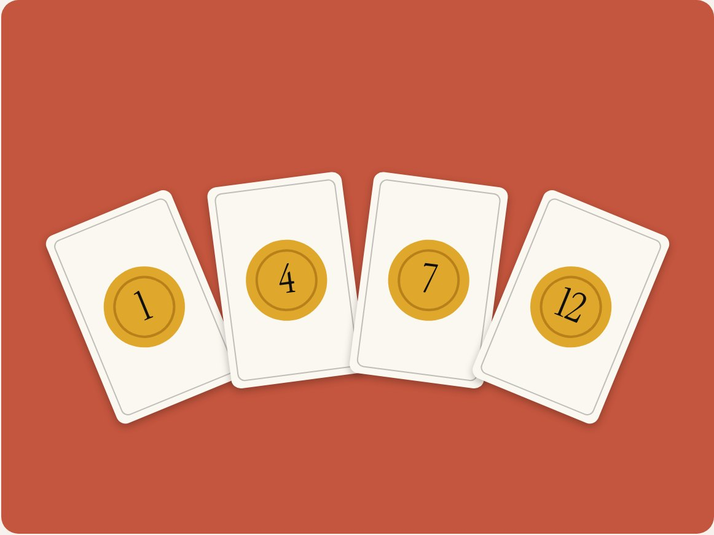</a><br><sub><code>/13</code> &nbsp; <code>QUANT & SIMULATION</code></sub><br><b><a href="#project-mus-stochastic-suite">Mus Suite</a></b><br>Early stage: the Spanish card game Mus, with bots and stochastic analysis.</td>
<td width="50%"></td>
</tr>
</table>

**Also on GitHub:** [3imat](https://github.com/claudialbombin/3imat) (Third-year iMAT coursework, just started) · [42](https://github.com/claudialbombin/42) (Piscine and cursus: Libft, ft\_printf, get\_next\_line, Born2beRoot (100/100))


<p align="center"></p>

## What I do

<table><tr><td width="33%" valign="top"><h3>Model</h3>Stochastic models for finance and decision-making: Monte Carlo, Markov decision processes, particle filters and QUBO. I care about the number, and about how far to trust it.</td><td width="33%" valign="top"><h3>Build</h3>Working software. Python to explore, C when speed and discipline matter, web and desktop apps for things people actually use. The engines here are checked against a known answer.</td><td width="33%" valign="top"><h3>Speak</h3>Debate, public speaking and mentoring: British Parliamentary, WUDC Panama 2025, U.S. Embassy programs. Explaining a hard idea clearly is part of the job.</td></tr></table>

## In numbers

<table><tr><td width="25%" valign="top"><h1>380/380</h1>blackjack chart decisions where my Monte Carlo solver agrees with an exact solver</td><td width="25%" valign="top"><h1>0.006%</h1>error of my Monte Carlo option pricer against the closed form</td><td width="25%" valign="top"><h1>10⁹</h1>simulated rounds in my Hi-Lo card-counting study</td><td width="25%" valign="top"><h1>3rd</h1>among all Spanish-speaking teams at the World Universities Debating Championship, Panama 2025</td></tr></table>


<p align="center"></p>

## Play with the numbers

<a href="https://claudialbombin.github.io/">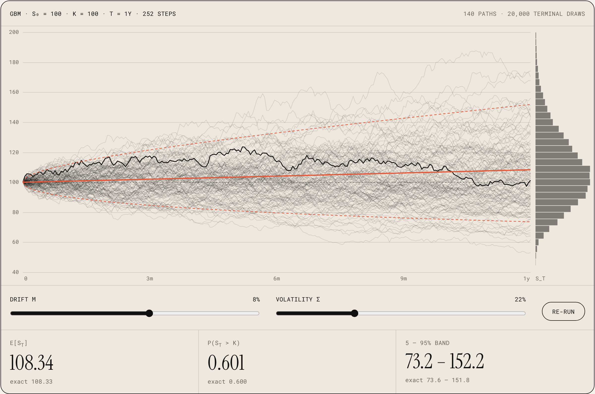</a>

**[Open in the browser to move the sliders ↗](https://claudialbombin.github.io/)**

Live, not a picture. Every run uses the same random numbers, so moving σ or μ shows only what the parameters change. The line through the middle is the exact mean, the dashed lines are the exact 5% and 95% quantiles, and the histogram on the right is the Monte Carlo estimate of S\_T. The same idea, in miniature, as my option pricer and my Heston filter.


<p align="center"></p>

## On stage

<table><tr><td width="42%"><br><sub><code>PUBLIC SPEAKING AT UNIVERSIDAD PONTIFICIA COMILLAS</code></sub></td><td valign="middle"><h3>Debate taught me to structure an argument, defend it under pressure and change my mind when the evidence says so. I compete and adjudicate in academic and British Parliamentary formats, and finished 3rd among all Spanish-speaking teams at WUDC Panama 2025. I have mentored through a U.S. Embassy program and Technovation Girls. At 42 Madrid I co-founded a debate league, and I built CeceCat, a tournament manager, to run this kind of event.</h3></td></tr></table>


<p align="center"></p>

## Right now

| | |
|---|---|
| **Thesis proposal on QUBO portfolio optimization** | `Quantum annealing and QAOA` |
| **Social Media &amp; Content Creator** | `ICAI · Universidad Pontificia Comillas` |
| **42 Madrid cursus** | `Common Core completed through Rank 02` |
| **Liga de Debate** | `Founding partner and trainer, 42 Madrid` |
| **Preparing for the CFA** | `Alongside the degree` |
| **Looking for summer 2027 internships** | `Quant, data and software · London or Madrid` |

## Recently on GitHub

| Project | | Date |
|---|---|---|
| [**pitwall**](#project-pitwall) | Results corrected across site, notebooks and paper | `Nov 2026` |
| [**42**](#project-a-maze-ing) | A-Maze-ing, in Python, and Born2beRoot | `Oct 2026` |
| [**salchi-helper**](#project-salchi-helper) | A floating dachshund for your to-do list | `Oct 2026` |
| [**beat-the-dealer**](#project-beat-the-dealer) | Rebuilt: exact solver, a billion rounds, a live site | `Sep 2026` |
| [**3imat**](https://github.com/claudialbombin/3imat) | Third-year iMAT coursework | `Sep 2026` |
| [**cececat**](#project-cececat) | A debate tournament manager | `Sep 2026` |


<p align="center"></p>

## About

<table><tr><td width="36%"></td><td valign="middle"><h3>I’m Claudia Lopez, Spanish born engineer, specialised in Mathematics and Artificial Intelligence.</h3><h3>After contributing to numerous engineering projects, mentoring programs, and debate competitions, I decided to focus on what drives me the most: creating meaningful, integrative experiences.</h3><h3>Lately that means stochastic models for finance: Monte Carlo, Markov processes, filtering. Now I’m crafting my own approach to multidisciplinary challenges.</h3></td></tr></table>

Over 5 years exploring the intersection of technology, data, and meaningful experiences. After engaging in diverse engineering, mentoring, and debate experiences, I chose to follow my passion: exploring new ways to merge technology, creativity, and human impact. Now, I’m shaping my own vision of purposeful projects.

**Programs & initiatives:** Technovation Girls, U.S. Embassy mentoring, ISC Racing Team, WUDC.

### How I work

**Check it against something known.** My Monte Carlo pricer is validated against the Black-Scholes closed form. My blackjack chart is checked cell by cell against an exact solver. If a model cannot be checked against something, I do not trust it yet.

**Write it twice.** Python to explore and see, C when speed and discipline matter. The option pricer and the blackjack solver each exist in both, and the two versions have to agree.

**Show the uncertainty.** Standard errors, convergence rates, a Gaussian Process that returns its own confidence. A number without its error bar is only half an answer. And when a result does not hold up, I say so: Pitwall’s page reports where the policy loses.

### Experience

**ISC Racing Team** · Cost Report Engineer · Formula Student · `2024 – ongoing`

Manage the Bill of Materials of a racing car with 500+ components, in full compliance with the cost regulations. Coordinated 4 technical subteams to align cost modelling with engineering constraints, cutting reporting discrepancies by 30%. Contributed to the Engineering Design Report and the Cost Explanation File, with a top-quartile score in static events.

**Liga de Debate · 42 Madrid** · Founding Partner &amp; Trainer · `2026 – ongoing`

Co-founded the league and designed its governance and point system on the Cambridge Union model. I lead argumentation and public speaking training.

**ICAI · Comillas** · Social Media &amp; Content Creator (intern) · `2026 – ongoing`

Plan, script and produce audiovisual content for ICAI’s channels, coordinating recordings with students.

**CMU Santa María del Pino** · Dean of Culture · `2024 – ongoing`

Member of the governing council representing 150+ residents. Ran 10+ cultural and professional events, with 200+ attendees.

**Inspire Girls** · `2020 – ongoing`

**Empower Peace** · `2022`

### Education

| | | |
|---|---|---|
| **ICAI · Comillas** | BSc in Mathematical Engineering &amp; AI (iMAT) · GPA 7.8/10 | `Expected May 2028` |
| **42 Madrid** | Fundación Telefónica · Common Core completed through Rank 02 · Born2beRoot 100/100 | `Cursus` |
| **Bachillerato &amp; IB** | Spanish Bachillerato (average 10/10) and International Baccalaureate | `2023` |

### Languages

| | |
|---|---|
| **Spanish** | Native |
| **English** | C2 Cambridge · TOEFL 110 · IELTS 8.0 |
| **French** | DELF A2 |

### Debate & leadership

| | |
|---|---|
| **WUDC Panama 2025** | 3rd among all Spanish-speaking teams · 200+ teams, 50+ countries |
| **BP Asun Almajano 2025** | Winner |
| **National Tournament of Madrid 2024** | Finalist. Also finalist at BP Comillas 2024 and BP Carlos III 2025 |
| **BP Regenta 2025** | Break &amp; Final Adjudicator · 100+ teams. Break Adjudicator at BP Mendel and BP Elías Ahuja 2025 |
| **Technovation Girls** | National Ambassador, Spain, 2020–2024 · 100+ teams a year, 15+ teams mentored |
| **Girl Global Get Ready** | U.S. Embassy, 2022–2024 · 20+ students mentored |

### Skills

`Python` `C` `SQL` `JavaScript` `LaTeX` `MATLAB` `NumPy` `Pandas` `scikit-learn` `Jupyter` `Streamlit` `Plotly` `Tableau` `Flask` `Swift` `Electron` `Firestore` `MySQL` `MongoDB` `Neo4j` `SciPy` `matplotlib` `pytest` `GitHub Actions` `Qiskit` `Monte Carlo` `MDP` `Gaussian Processes` `Particle filters` `QUBO`

### Outside the screen

I like board games and card games, and it shows: two of my projects are about them. I also care about the small design details that make software feel cared for.


<p align="center"></p>

## Every project in detail

Open a project to read the question, the method and the numbers. Each one also has its own page on the site.

<a id="project-pitwall"></a>
<details>
<summary><code>/01</code> <b>Pitwall</b>: When to pit in Formula 1, solved like an American option, and honest about the result.</summary>

<br>


A stochastic pit-stop strategy optimizer for Formula 1. It frames the decision of when to pit as a finite-horizon Markov Decision Process solved by backward induction, with tyre wear modelled by Gaussian Process regression and safety-car risk by a Bayesian Poisson process. It also follows live sessions and publishes its advice for €0.

| Type | Stack | Methods |
|---|---|---|
| Personal project | Python · FastF1 · Web | MDP · GPR · Monte Carlo |

[Page on the site ↗](https://claudialbombin.github.io/#/works/pitwall) · [GitHub: pitwall ↗](https://github.com/claudialbombin/pitwall) · [Live site ↗](https://claudialbombin.github.io/pitwall/)

<table><tr><td valign="top" width="25%"><h2>53%</h2>of 57 comparisons with real 2023 strategies where the policy was faster (modelled time)</td><td valign="top" width="25%"><h2>+0.20 s</h2>mean modelled delta in those comparisons</td><td valign="top" width="25%"><h2>48 s</h2>slower than a baseline heuristic in the saved Silverstone Monte Carlo run</td><td valign="top" width="25%"><h2>€0</h2>monthly cost of the live-timing feature</td></tr></table>

#### The question

Every lap a race engineer faces the same call: pit now, or stay out on tyres that are wearing? A stop costs a guaranteed 19 to 24 seconds in the pit lane, depending on the circuit. Staying out costs an uncertain lap-time loss that grows as the tyres degrade. And a safety car can appear at any moment and make an otherwise poor stop almost free.

Rules of thumb such as “pit around lap 25” ignore all of that. Pitwall treats the race as what it is: a sequential decision under uncertainty.

#### The model

The race is a Markov Decision Process. At every lap the state tracks:

- the lap number
- the tyre compound (soft, medium, hard, intermediate, wet)
- the age of the tyres, in laps
- the position, from 1 to 20
- the discretised gaps to nearby cars
- the number of stops already made
- whether a safety car or virtual safety car is active

The action each lap is to stay out or to pit, choosing a compound. The objective is not greedy: it minimises the expected total race time over the laps that remain. The value function comes from a Bellman equation solved by backward recursion, which asks one question: is the immediate cost of pitting better than the expected value of waiting one more lap?

#### Tyres and safety cars

A Weibull hazard is fitted per compound to look for a degradation cliff. The saved fits are weak, with negative R², and find no clear cliff. On top sits a Gaussian Process with a Matérn 5/2 kernel, for the variation between circuits and temperatures. The model returns both a lap-time delta and its uncertainty.

```
delta, uncertainty = model.predict(Compound.MEDIUM, tyre_age=22, return_std=True)
```

Safety cars are a non-homogeneous Poisson process for timing and a geometric distribution for duration, with a Bayesian layer that updates the deployment rate of each circuit from historical data.

#### Results

I corrected these numbers in November 2026 so that the site, notebooks and paper match the saved results. Against 57 real driver strategies from 2023, at 3 circuits, the policy is faster in 53% of comparisons, by a mean of 0.20 seconds. This is not yet a proven strategy edge.

| Circuit | Policy faster | Mean delta |
|---|---|---|
| Monaco | 85% | +1.01 s |
| Silverstone | 72% | +0.08 s |
| Monza | 0% | −0.54 s |

At Silverstone the MDP recommended lap 26. That beat Verstappen’s real lap 34 by 0.41 s and Gasly’s lap 32 by 0.33 s, but lost to Leclerc’s lap 19 by 0.52 s.

- In the saved Monte Carlo run at Silverstone (N = 2,000), the MDP averages 81.73 minutes against 80.93 for the baseline: 48 s slower.
- The deltas are modelled, not observed, and each circuit gets one recommended lap.
- The safety-car 90% intervals cover only 8% of laps.

#### Live, for €0

A GitHub Actions job checks the calendar every 5 minutes. When a session is live, another job connects to the same Formula 1 SignalR feed FastF1 is built on, and every few seconds asks the same solver used offline what it would do given the real gaps, tyres and safety-car status. The snapshot goes to a git branch, and a static page polls it. No server, no database and no paid feed.

#### The finance connection

The most interesting result is an isomorphism. Deciding whether to pit now or wait is the same problem as deciding whether to exercise an American option early: compare the immediate payoff with the expected value of continuing, and solve it by backward recursion. The same Snell-envelope machinery from quantitative finance applies to race strategy.

#### Inside the repo

- core/: MDP formulation, solver, tyre and safety-car models, race simulator.
- data/: the FastF1 pipeline. live/: the live-timing companion.
- paper/: a full mathematical write-up.
- results/: backtest CSV and diagnostic plots. tests/: pytest suite.
- A static GitHub Pages site with a Simulator, a Live dashboard, The Math and a Garage of animated pit-stop scenarios.

</details>

<a id="project-beat-the-dealer"></a>
<details>
<summary><code>/02</code> <b>Beat the Dealer</b>: Blackjack solved by simulation, checked against an exact solver, and counted over a billion rounds.</summary>

<br>


Blackjack basic strategy derived by Monte Carlo simulation, checked cell by cell against an exact solver, and a Hi-Lo card-counting study over one billion simulated rounds. It comes with an interactive site where you can play, drill and run the simulations yourself.

| Type | Stack | Methods |
|---|---|---|
| Personal project | Python · NumPy · C11 · JavaScript | Monte Carlo · Exact solver · Hi-Lo |

[Page on the site ↗](https://claudialbombin.github.io/#/works/beat-the-dealer) · [GitHub: beat-the-dealer ↗](https://github.com/claudialbombin/beat-the-dealer) · [Live site ↗](https://claudialbombin.github.io/beat-the-dealer/)

<table><tr><td valign="top" width="25%"><h2>380/380</h2>chart decisions where Monte Carlo agrees with the exact solver</td><td valign="top" width="25%"><h2>10⁹</h2>simulated rounds in the counting study</td><td valign="top" width="25%"><h2>0.696%</h2>house edge with perfect basic strategy, ±0.007% (95% CI)</td><td valign="top" width="25%"><h2>+0.50%</h2>player edge gained per +1 of Hi-Lo true count</td></tr></table>

#### Thorp, 1962

Edward O. Thorp’s Beat the Dealer gave us the first computer-derived basic strategy and card-counting system. This project redoes that work with modern tools, and tests every step.

#### Basic strategy by simulation

For every decision and every legal action, the solver simulates the rest of the hand 2,000,000 times and averages the profit. Two details make it a correct solver and not a heuristic:

- Backward induction: after a hit, the rest of the hand must be played optimally too, so states are solved in an order where everything a hit can lead to is already known.
- Common random numbers: the actions are compared against the same simulated dealer hands, so a difference reflects the decision and not sampling luck.

With NumPy vectorisation and one process per dealer upcard, it runs in about two minutes.

#### The exact reference

With an infinite deck every draw is independent, so the game can be solved exactly by recursion. All 380 chart cells agree. Three of them (11 vs A, 16 vs 10, soft 15 vs 4) are statistical ties at 2M hands, and the exact solver confirms the Monte Carlo pick. The exact solver itself matches the published 6-deck chart in every cell except soft 13 vs 5, a known card-removal effect.

#### What counting is worth

A C11 port plays the real 6-deck shoe at about 5 million rounds per second per thread. The conclusion is honest: counting works, but in this game the edge is thin. The count predicts the next hand very reliably, but only about a quarter of rounds are dealt at a positive count.

| Metric | Value |
|---|---|
| House edge, perfect basic strategy | 0.696% ± 0.007% |
| Edge per +1 true count | +0.50% |
| True count where the player gains the edge | ≈ +0.9 |
| Counter’s edge, 1–12 spread | +0.19% |
| Counter’s edge, 1–8 spread, leaving at negative counts | +0.80% |

Limits: the counter never deviates from the chart, the chart uses the infinite-deck model, and surrender, re-splitting and insurance are not modelled.

#### The site

- Play: a full table with a coach that grades every decision and shows the expected-value cost of mistakes.
- Drill: rapid two-card decisions at their real frequencies, with a mastery map.
- Strategy chart: change a rule and the whole game is re-solved in the browser.
- Monte Carlo lab: watch estimates and their 95% bands converge on the exact answer.
- Card counting: a betting ramp you can edit, with edge, variance, N0 and risk of ruin.

It uses plain ES modules with no framework and no build step. The exact solver is ported to JavaScript and checked against the Python values to 10⁻⁶. The Python and C implementations are tested against each other, with CI across all three languages.

</details>

<a id="project-monte-carlo-option-pricer"></a>
<details>
<summary><code>/03</code> <b>Option Pricer</b>: European, Asian and barrier options under Black-Scholes and Heston, in Python and C.</summary>

<br>


A pricing engine for European, Asian and barrier options under two models: Black-Scholes, with constant volatility, and Heston, where volatility itself is random. It estimates the Greeks three ways and compares them on variance. Written twice, in Python and in C.

| Type | Stack | Methods |
|---|---|---|
| Personal project | Python · C · pytest | Monte Carlo · Black-Scholes · Heston |

[Page on the site ↗](https://claudialbombin.github.io/#/works/monte-carlo-option-pricer) · [GitHub: monte-carlo-option-pricer ↗](https://github.com/claudialbombin/monte-carlo-option-pricer)

<table><tr><td valign="top" width="25%"><h2>0.006%</h2>relative error at 500K paths against the closed form</td><td valign="top" width="25%"><h2>77</h2>unit tests in Python</td><td valign="top" width="25%"><h2>~6×</h2>lower variance, pathwise vs likelihood-ratio Greeks</td><td valign="top" width="25%"><h2>2×</h2>faster in C than in Python for 500K paths</td></tr></table>

#### Why

The project is built to show quantitative finance through implementation rather than theory alone: apply stochastic calculus, understand how Monte Carlo converges, know the trade-offs between ways of computing Greeks, and write the same engine in two languages. It does all of that, end to end.

#### Two models

Black-Scholes assumes constant volatility. It has an exact solution, which makes it the ground truth everything else is checked against. Heston lets volatility be random and mean-reverting:

```
dS = r·S·dt + √v·S·dW¹
dv = κ(θ − v)·dt + ξ·√v·dW²
corr(dW¹, dW²) = ρ
```

- κ = 2.0, the speed of mean reversion
- θ = 0.04, the long-run variance
- ξ = 0.30, the volatility of volatility
- ρ = −0.70, the leverage correlation

Heston has no closed form, so it is simulated with an Euler–Maruyama scheme that absorbs the variance at zero, with correlated Brownian increments built through a Cholesky decomposition. The discretisation bias is linear in the time step; at daily steps it is around 0.01 to 0.02, small next to the Monte Carlo error.

#### Three options

| Option | Payoff | Price | Note |
|---|---|---|---|
| European call, closed form | max(S\_T − K, 0) | 10.4506 | ground truth |
| European call, Monte Carlo (500K paths) | max(S\_T − K, 0) | 10.4512 | 0.006% error |
| Asian call, arithmetic average | max(avg S − K, 0) | 5.8234 | 44.3% cheaper than European |
| Up-and-out barrier call, B = 120 | max(S\_T − K, 0) if max S &lt; B | 6.1245 | 41.4% cheaper; 23.45% chance of knock-out |

Averaging lowers the effective volatility, which is why the Asian option costs less. The barrier option costs less because it can be knocked out. Under Heston, at-the-money prices sit within ±2% of Black-Scholes; the differences grow in the tails.

#### Convergence

The Monte Carlo error falls as 1/√N: ten times more paths cut it by about 3.16. The measured standard errors follow the theoretical line almost exactly.

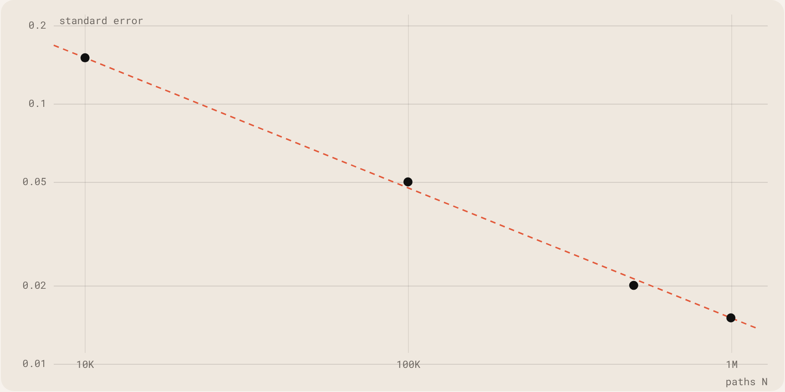

<sub>Standard error against paths, log-log. Dots: 10K, 100K, 500K and 1M paths from the README. Dashed: the 1/√N line through the first point.</sub>

#### Greeks, three ways

Pathwise differentiates the payoff: very low variance, but it needs a smooth payoff. Likelihood ratio differentiates the probability density: it works for any payoff, at the price of noise. Finite differences reprice twice and are the reference. Against the Black-Scholes closed form:

| Method | Delta | Error | Vega | Error |
|---|---|---|---|---|
| Black-Scholes | 0.6368 | – | 37.524 | – |
| Pathwise | 0.6370 | 0.025% | 37.530 | 0.016% |
| Likelihood ratio | 0.6372 | 0.065% | 37.541 | 0.046% |
| Finite differences | 0.6368 | 0.013% | 37.522 | 0.005% |

Pathwise has a standard error of about 0.0002; likelihood ratio about 0.0012, roughly six times more. The barrier option shows why you need both: its payoff is discontinuous, so the pathwise estimate is unreliable, while likelihood ratio gives a delta of 0.3452, in line with finite differences at about 0.34.

#### Python and C

|  | Python | C |
|---|---|---|
| 500K paths | ~10 s | ~5 s |
| Style | object-oriented | procedural |
| Dependencies | NumPy, SciPy, Matplotlib | none, standard library only |
| RNG | PCG-64 | Mersenne Twister (MT19937) |
| Normal CDF | scipy.stats | Abramowitz &amp; Stegun |
| Memory | garbage collected | malloc / free |

- MT19937 instead of rand(): a period of 2^19937−1 against 2^31−1, better statistics and reproducible runs.
- Box–Muller for normals, caching the second one so each normal costs one uniform on average.
- Manual memory, because Heston with many steps needs around 800 MB and stack arrays are not enough.
- A normal CDF approximation with a maximum error of 7.5×10⁻⁸, far below the Monte Carlo error, which removes the need for GSL.

#### Tests

The Python side has 77 tests: 24 for the models, 26 for the options and 27 for the Greeks. The C side has an integrated test mode that checks results against deterministic seeds.

```
cd python && pip install -r requirements.txt && python main.py
cd C && make && make run
```

</details>

<a id="project-salchi-helper"></a>
<details>
<summary><code>/04</code> <b>Salchi</b>: A floating dachshund that keeps your to-do list in sight, on Mac, Windows and Linux.</summary>

<br>


Checking your to-do list shouldn’t be another to-do. Salchi is a tiny dachshund that sits on top of everything on your screen, typing at its laptop. The sticker on the laptop shows how many tasks are left. Hover over it and the whole list opens.

| Type | Stack | Methods |
|---|---|---|
| Personal project · released | Swift · Electron · Apps Script | Desktop apps · Product design |

[Page on the site ↗](https://claudialbombin.github.io/#/works/salchi-helper) · [GitHub: salchi-helper ↗](https://github.com/claudialbombin/salchi-helper)

<table><tr><td valign="top" width="33%"><h2>3</h2>platforms: macOS, Windows and Linux</td><td valign="top" width="33%"><h2>2</h2>editions: synced with Notion, or entirely local</td><td valign="top" width="33%"><h2>1</h2>glance to see what is left</td></tr></table>

#### What it does

- Floats above every app, on every desktop, even over full-screen windows.
- Hover to see the list; move away and it folds back. Drag it anywhere, or pin the list open.
- Due dates with an optional time: overdue tasks turn red, today’s turn orange, and the list sorts itself.
- Dated tasks can appear in Google Calendar.
- In the Notion edition, an assistant connected to your Notion can add tasks for you.

#### Two editions

Every platform comes in two flavours that share all of their code. With Notion, a database is the back end, so the same list reaches every computer and your phone. Without it, tasks live in a small file on your computer: no accounts, no setup and nothing leaves the machine.

#### How it is built

| Part | Built with | In short |
|---|---|---|
| Mac | Swift, SwiftUI, AppKit | A borderless panel that never steals focus, plus a menu-bar counter |
| Windows · Linux | Electron | One code base, packaged as an installer, an AppImage and a .deb |
| Calendar | Google Apps Script | Mirrors dated Notion tasks into Google Calendar |

- The app talks to one task-store interface with two implementations; the edition is chosen at packaging time.
- Optimistic updates: the screen changes instantly, the save runs in the background and rolls back if it fails.
- A hover that never gets stuck: the window resizes under the cursor, so the apps watch its position themselves.
- End-to-end tests drive the real desktop interface against a fake Notion.

</details>

<a id="project-cececat"></a>
<details>
<summary><code>/05</code> <b>CeceCat</b>: A debate tournament manager that runs entirely from one web page.</summary>

<br>


A pairs-based debate tournament manager. Create a tournament with a guided wizard, generate each round’s pairings, distribute judges, collect scores by hand or live from each judge’s phone, and keep the standings. There is no server to run and nothing to install: index.html is one file.

| Type | Stack | Methods |
|---|---|---|
| Personal project | JavaScript · Firestore · EmailJS | Pairing · Assignment |

[Page on the site ↗](https://claudialbombin.github.io/#/works/cececat) · [GitHub: cececat ↗](https://github.com/claudialbombin/cececat) · [Live site ↗](https://claudialbombin.github.io/cececat/)

<table><tr><td valign="top" width="25%"><h2>2</h2>formats: Academic and British Parliamentary</td><td valign="top" width="25%"><h2>6</h2>steps to create a tournament</td><td valign="top" width="25%"><h2>3</h2>layers of backup</td><td valign="top" width="25%"><h2>1</h2>HTML file holds the whole app</td></tr></table>

#### Why

I compete in debate, and running a tournament means pairings, rooms, judges and scores under time pressure. CeceCat puts all of it on one page that keeps working offline. The two optional parts, live scores and judge emails, simply stay off if they are not configured.

#### Judges that really rotate

For each round the algorithm compares every possible combination of room and judge and keeps the one with the fewest repeats. It does not decide room by room in a fixed order, so who shares a panel really changes from round to round.

- A trainee is never the chair of a room if another judge is available.
- It avoids repeating a judge pairing, and a judge seeing the same team twice.
- It repairs itself: after a reload or an old backup, it rebuilds each judge’s history from the rounds already played.

#### Pairings and scores

Rounds are paired by standings, avoid repeat opponents where possible and balance who has held each position. Each judge gets one link for the whole tournament. Only the chair can send a score from it, and the central desk always reviews it before it counts.

#### Nothing gets lost

- Automatic saving in the browser on every change.
- A downloadable .json copy to continue on another computer, and a readable .txt report.
- Automatic snapshots per round to a folder on disk, using the File System Access API in Chromium browsers.

It also imports PDFs offline, with an embedded library.

</details>

<a id="project-scm-heston-filter"></a>
<details>
<summary><code>/06</code> <b>Heston Filter</b>: A particle filter that tracks a volatility nobody can observe.</summary>

<br>


A particle filter that tracks volatility, which nobody observes, from prices, which are noisy. It implements Sequential Monte Carlo on the Heston stochastic-volatility model.

| Type | Stack | Methods |
|---|---|---|
| Personal project | Python | Sequential Monte Carlo · Heston |

[Page on the site ↗](https://claudialbombin.github.io/#/works/scm-heston-filter) · [GitHub: scm-heston-filter ↗](https://github.com/claudialbombin/scm-heston-filter)

#### The problem

In the Heston model volatility is not a number you can look up. It is a hidden state that moves randomly and can only be seen through prices, which carry noise. To price an option or measure risk you still need it. So the question is how to recover a moving, unobserved quantity from noisy observations.

#### The model

```
dS = r·S·dt + √v·S·dW¹
dv = κ(θ − v)·dt + ξ·√v·dW²
corr(dW¹, dW²) = ρ
```

The price follows one equation and its variance v follows another, correlated with the first. Only the price is observed.

#### The method

A particle filter keeps a cloud of hypotheses about the hidden variance, called particles. At each step every particle is moved forward with the model’s dynamics and weighted by how well it explains the price that was actually observed. The cloud is then resampled so that good hypotheses multiply and bad ones disappear. The result is a running estimate of the latent volatility, with its uncertainty, that updates as each new price arrives.

#### In this repo

A Python implementation of that filter on the Heston model, under the MIT licence. It is the companion of my option pricer: the pricer simulates Heston forward, the filter works backward from data.

</details>

<a id="project-tfg"></a>
<details>
<summary><code>/07</code> <b>QUBO Thesis</b>: Portfolio selection as a problem quantum annealers can read.</summary>

<br>


Research proposal for a bachelor’s thesis on QUBO formulations of cardinality-constrained portfolio optimization: holding only k assets out of many. It connects discrete mathematics, quantum annealing on D-Wave and QAOA in Qiskit to quantum finance.

| Type | Stack | Methods |
|---|---|---|
| Thesis proposal · in progress | LaTeX · Qiskit · D-Wave | QUBO · Quantum annealing · QAOA |

[Page on the site ↗](https://claudialbombin.github.io/#/works/tfg)

#### The problem

Markowitz portfolio theory tells you how to weight assets. Real investors also want to hold only a handful of them: k out of hundreds. That cardinality constraint turns a smooth optimisation into a combinatorial one, which is NP-hard in general.

#### The idea

A QUBO, quadratic unconstrained binary optimisation, asks for the binary vector x that minimises xᵀQx. Each binary variable says whether an asset is in the portfolio. Risk and expected return become entries of Q, and the cardinality constraint is folded in as a penalty that grows when the number of selected assets is not k. Once a problem is a QUBO, it can be handed to hardware that speaks that language.

```
min  xᵀQx      x ∈ {0,1}ⁿ
penalty:  λ · (Σ xᵢ − k)²
```

#### Two quantum routes

- Quantum annealing on D-Wave, hardware built to minimise exactly this kind of energy function.
- QAOA in Qiskit, the variational algorithm for gate-based quantum computers.

#### Status

The research proposal is finalised and written up as a full LaTeX document. The thesis runs from 2026 to 2028.

</details>

<a id="project-pause"></a>
<details>
<summary><code>/08</code> <b>Pause</b>: A breathing exercise before the apps you cannot put down.</summary>

<br>


A mindful friction layer for addictive apps. Before Instagram, TikTok, YouTube or any app you choose, it opens a short breathing exercise. It breaks the autopilot habit loop without hard blocking.

| Type | Stack | Methods |
|---|---|---|
| Personal project | HTML · JavaScript | Product design |

[Page on the site ↗](https://claudialbombin.github.io/#/works/pause) · [GitHub: pause ↗](https://github.com/claudialbombin/pause) · [Live site ↗](https://claudialbombin.github.io/pause/)

#### The problem

Most of the time you do not decide to open Instagram; your thumb does. The habit loop runs on autopilot: trigger, open, scroll.

#### The idea

Pause adds a small amount of friction at exactly that moment. Before Instagram, TikTok, YouTube or any app you choose, it opens a short breathing exercise. Nothing is blocked; the point is to give you one breath in which to decide.

- Friction instead of blocking, to interrupt the habit without fighting the person using it.
- You choose which apps trigger it.

#### Under the hood

Built with plain HTML and JavaScript. The repository includes a web app manifest, so it can behave like an installable app.

</details>

<a id="project-recetario-familiar"></a>
<details>
<summary><code>/09</code> <b>Recetario</b>: A cozy family recipe book with a page-turning cover, on the web.</summary>

<br>


A cozy recipe book for the family, built as a web app and deployed to GitHub Pages: a book that opens, turns its pages and scales every recipe to the number of people at the table.

| Type | Stack | Methods |
|---|---|---|
| Personal project | HTML · CSS · JavaScript | Web app · UI design |

[Page on the site ↗](https://claudialbombin.github.io/#/works/recetario-familiar) · [GitHub: recetario-familiar ↗](https://github.com/claudialbombin/recetario-familiar) · [Live site ↗](https://claudialbombin.github.io/recetario-familiar/)

#### The brief

A place for the family’s recipes to live, that feels handmade rather than like software. The look comes from an embroidered striped tote bag: burgundy and cream ticking stripes, cross-stitch borders, floral embroidery and leather accents, translated into a digital cookbook.

#### What it does

- A 3D book-opening animation with page-flip transitions and a two-page spread, which switches to a single continuous layout on phones.
- Add, edit and delete recipes, with photo upload and in-browser image compression.
- Chapters and categories you can add, rename and delete.
- A spice level from 1 to 5 chillies, vegan and vegetarian flags, and free-form tags.
- A servings scaler that recalculates ingredient quantities proportionally.
- Search across title, ingredients, category and tags, and a filter by diet and chapter.

#### How it is built

One standalone index.html with no build step, deployed on GitHub Pages, with recipes stored in the browser. The two-page book needed JavaScript viewport detection, because CSS alone could not serve the phone and desktop layouts properly. Native browser dialogs were replaced by custom modals. It went from first concept to a deployed product in one long working session.

</details>

<a id="project-a-maze-ing"></a>
<details>
<summary><code>/10</code> <b>A-Maze-ing</b>: A reproducible maze generator with a “42” in the middle, in Python, at 42 Madrid.</summary>

<br>


A maze generator written with a partner for the 42 Madrid curriculum. It reads a configuration file, generates a maze that is always the same for the same seed, writes it to a file with one hexadecimal digit per cell and draws it in the terminal in colour.

| Type | Stack | Methods |
|---|---|---|
| Coursework · 42 Madrid | Python · flake8 · mypy | Graph algorithms |

[Page on the site ↗](https://claudialbombin.github.io/#/works/a-maze-ing) · [GitHub: 42/A-maze-ing ↗](https://github.com/claudialbombin/42/tree/main/Cursus/Rank02/A-maze-ing)

#### Two kinds of maze

- Perfect: exactly one path between the entry and the exit, with no loops.
- Not perfect: a board for a Pac-Man-like game, with many loops and no dead ends beyond those closed by the “42”.

#### The algorithm

The default is a recursive backtracker, a random depth-first search that produces a spanning tree of the cells, which is what makes the maze perfect. It uses a list as a stack and not real recursion, because Python reaches its recursion limit on big mazes. Prim’s algorithm is available as an option.

#### Details

- The generator is a separate package, mazegen, built as a wheel so a later project can reuse it.
- A menu regenerates the maze, shows the shortest path and rotates the colours.
- Bad configuration always stops with a clear message, never with a traceback.

</details>

<a id="project-push-swap"></a>
<details>
<summary><code>/11</code> <b>push_swap</b>: Sorting with two stacks and a handful of moves, in C, at 42 Madrid.</summary>

<br>


The push\_swap project from the 42 Madrid C curriculum: sort a stack of integers using a second stack and a very small set of operations, in as few moves as possible. Built with a partner, in a variant that picks its strategy by how disordered the input is. Finished, with the bonus checker.

| Type | Stack | Methods |
|---|---|---|
| Coursework · 42 Madrid | C | Sorting · Complexity |

[Page on the site ↗](https://claudialbombin.github.io/#/works/push-swap) · [GitHub: 42/push\_swap ↗](https://github.com/claudialbombin/42/tree/main/Cursus/Rank01/push_swap)

#### The exercise

It is a sorting problem where the cost is not time but the number of operations. You can only push between two stacks, swap, and rotate, so every algorithm has to be judged by how many moves it prints.

#### This version

A disorder index, computed by counting inversions, measures how far the input is from sorted. An adaptive mode uses it to pick a strategy. Each one can also be forced with a flag, and a benchmark mode reports the index, the strategy and the operations by type.

| Flag | Strategy | Class |
|---|---|---|
| --simple | Selection-based | O(n²) |
| --medium | Chunk-based | O(n√n) |
| --complex | LSD radix | O(n log n) |
| --adaptive | Picks one of the above | depends on input |

Inputs of up to 5 numbers get an exhaustive-search optimal sort. My partner wrote the parsing module.

#### The rules of the game

The 42 Norm limits what the code may look like:

- At most 25 lines per function, 5 functions per file and 4 parameters per function.
- No for loops, no ternary operators.
- No global variables: the benchmark structure is passed by pointer through every function.

</details>

<a id="project-2imat"></a>
<details>
<summary><code>/12</code> <b>iMAT Year 2</b>: A year of Mathematical Engineering and AI: 11 courses, 40+ assignments, 8 final projects.</summary>

<br>


The coursework hub for my second year of Mathematical Engineering and AI at ICAI: 11 courses, more than 40 assignments and 8 final projects, kept in the open in one repository.

| Type | Stack | Methods |
|---|---|---|
| Coursework · ICAI | Python · MATLAB · C · SQL | ML · Databases · Numerical methods |

[Page on the site ↗](https://claudialbombin.github.io/#/works/2imat) · [GitHub: 2imat ↗](https://github.com/claudialbombin/2imat)

<table><tr><td valign="top" width="25%"><h2>11</h2>courses</td><td valign="top" width="25%"><h2>40+</h2>assignments</td><td valign="top" width="25%"><h2>8</h2>final projects</td><td valign="top" width="25%"><h2>474K</h2>Amazon reviews in the recommender project</td></tr></table>

#### The courses

Data Acquisition, Machine Learning, Databases, Human Cognition and AI, Differential Equations, Foundations of AI, Operating Systems, Discrete Mathematics, Numerical Methods, Electronic Systems and Data Visualization.

#### Projects worth opening

- A hybrid recommender system over 474K Amazon reviews, spread across three kinds of database, with an interactive dashboard.
- A reproduction of the Ariane 5 failure, showing how a floating-point overflow brings down a rocket.
- The Lorenz system and the Van der Pol oscillator: chaos and limit cycles, visualised.
- Student success prediction with several classification algorithms.
- GPS shortest-path routing over Madrid’s real street network.
- A Bluetooth-controlled Raspberry Pi sensor dashboard.

#### Tools

Python, MATLAB, C and Bash; scikit-learn, NumPy and pandas; MySQL, MongoDB and Neo4j; Plotly and Flask; and a Raspberry Pi.

</details>

<a id="project-mus-stochastic-suite"></a>
<details>
<summary><code>/13</code> <b>Mus Suite</b>: Early stage: the Spanish card game Mus, with bots and stochastic analysis.</summary>

<br>


A planned suite for the Spanish card game Mus: playable against bots, with a tutorial and two stochastic analysis engines, in Python and C, to model strategy. It is at an early stage, and the repository holds only the initial plan so far.

| Type | Stack | Methods |
|---|---|---|
| Personal project · early stage | Python · C (planned) | Simulation · Game analysis |

[Page on the site ↗](https://claudialbombin.github.io/#/works/mus-stochastic-suite) · [GitHub: mus-stochastic-suite ↗](https://github.com/claudialbombin/mus-stochastic-suite)

#### The game

Mus is a Spanish card game played in pairs with the 40-card Spanish deck. Each hand is bid over four phases: grande, chica, pares and juego. It mixes probability with bluffing and with communication between partners, which makes it a good subject for simulation.

#### The plan

- Local multiplayer, and solo play against bots of adjustable difficulty.
- A guided tutorial for beginners.
- A cloud extension for online play.
- Two engines, in Python and C, that simulate thousands of games to model optimal strategies.

</details>

<sub>Cover images for the projects, except Salchi, are generated by the site to illustrate each idea. They are not output from the projects.</sub>


<p align="center"></p>

## Contact

<a href="mailto:claudialbombin@gmail.com">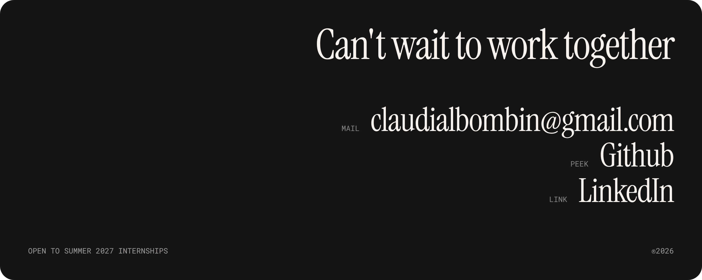</a>

**Mail:** [claudialbombin@gmail.com](mailto:claudialbombin@gmail.com) · **GitHub:** [claudialbombin](https://github.com/claudialbombin) · **LinkedIn:** [claudia-lopez-bombin](https://www.linkedin.com/in/claudia-lopez-bombin) · **Web:** [claudialbombin.github.io](https://claudialbombin.github.io/)

`OPEN TO SUMMER 2027 INTERNSHIPS`

### About this repository

This repository is the source of the site. It is one static `index.html`, bilingual, with no framework and no build step, and GitHub Pages serves it as it is.

**What is in here**

```
index.html         the whole site: content, styles and scripts
assets/            photos and the Salchi cover
assets/readme/     images used only by this README
.nojekyll          tells GitHub Pages to serve the files as they are
README.md          this file, in English
README.es.md       the Spanish version
```

**Run it locally**

```bash
git clone https://github.com/claudialbombin/claudialbombin.github.io.git
cd claudialbombin.github.io
python3 -m http.server 8000
# http://localhost:8000
```
